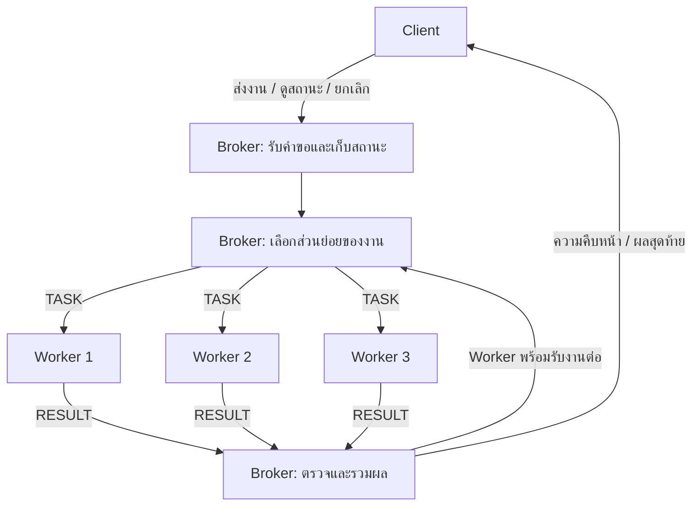

**Project ของเราคือ “ระบบวิเคราะห์ Log แบบหลาย Process ที่รับหลายคำขอผ่าน Async IPC แล้วใช้ Broker แบ่งงาน จัดคิว และรวมผลอย่างถูกต้อง”**

ชื่อที่ใช้เรียกได้คือ **Asynchronous Multi-Process Log Analyzer**

สิ่งที่เราจะศึกษาคือ เมื่อหลาย Process ต้องร่วมกันทำงาน เราจะออกแบบการสื่อสาร การจัดสรรงาน และการจัดการสถานะอย่างไร ให้ระบบยังตอบสนองได้ระหว่างที่งานบางส่วนกำลังประมวลผล และจะพิสูจน์คุณภาพของการออกแบบนั้นด้วยผลการทดลองอย่างไร

ภาพรวมด้านล่างรวมสิ่งที่คุยกันไว้ทั้งหมด และเพิ่มการทดลองบน MOS Simulator เพื่อเชื่อมกับ Source ของวิชาโดยตรง

---

**1. ขอบเขตของระบบที่จะสร้าง**

โปรเจกต์มีสองส่วนที่เชื่อมกัน:

| ส่วน | สิ่งที่จะทำ | จุดประสงค์ |
|---|---|---|
| **ระบบหลักบน Windows** | C++ มี Client, Broker และ Worker หลาย Process สื่อสารด้วย Named Pipes และ Overlapped I/O | ลงมือทำ Async IPC, Concurrency, การจัดคิว และการรวมผล |
| **การทดลองประกอบบน MOS Simulator** | ต่อยอด MOS with Semaphore จากการส่งข้อมูลหนึ่งช่องเป็น Buffer หลายช่อง พร้อม Trace การทำงาน | แสดง Interrupt, Context switching, Process queue และ Semaphore จาก Source ของวิชา |

ระบบหลักรันบน **Windows เครื่องเดียว** โดยค่าเริ่มต้นมี:

- Client 1 Process
- Broker 1 Process
- Worker 3 Process

ส่วนการทดลองสามารถเปลี่ยนจำนวน Worker เพื่อศึกษาผลต่อประสิทธิภาพได้

แต่ละ Process มีหน่วยความจำของตัวเอง ส่วนที่จำลองคือข้อมูล Log และสถานการณ์โหลดงาน เช่น งานใหญ่ งานเล็ก Worker ช้า หรือ Worker หลุด

**Windows ดูแลการจัดสรร CPU ส่วน Broker ของเราดูแลการจัดสรรงานให้ Worker** การทดลองบน MOS จะช่วยเปิดให้เห็นกลไกระดับล่างที่ระบบปฏิบัติการทำให้เราอีกชั้นหนึ่ง

---

**2. Application ของเราทำอะไร**

Application รับคำขอวิเคราะห์ Log แล้วคืนผลการนับ Error สองประเภท:

| ประเภทงาน | คำถามที่ต้องตอบ | ตัวอย่างผล |
|---|---|---|
| **Error by Route** | Route ไหนเกิด Error กี่ครั้ง | `/login: 120`, `/payment: 45` |
| **Error by Time** | Error เกิดมากในช่วงเวลาไหน | `10:00: 30`, `10:01: 85` |

Log แต่ละรายการมีข้อมูลอย่างน้อย:

- เวลาเกิดเหตุการณ์
- Route
- HTTP status

เราจะกำหนดกติกาข้อมูลให้ชัด เช่น นับสถานะ `400–599` เป็น Error และสามารถแยกจำนวน `4xx` กับ `5xx` ได้ ส่วนการนับตามเวลาจะใช้ช่วงเวลาที่กำหนดเหมือนกันทุก Process

ข้อมูลที่ใช้ทดลองจะเป็น Log ที่สร้างขึ้นอย่างควบคุมได้ โดยกำหนด:

- จำนวนบรรทัด
- สัดส่วน Error
- จำนวน Route
- การกระจายของ Error ตามเวลา
- Seed สำหรับสร้างข้อมูลซ้ำ

จึงสามารถสร้างสถานการณ์ เช่น “Error กระจุกอยู่ที่ `/payment`” หรือ “Error เพิ่มขึ้นในบางช่วงเวลา” และตรวจได้ว่าผลที่ระบบคืนมาถูกต้อง

**งาน A และงาน B เป็นคนละคำขอได้ แม้จะวิเคราะห์ไฟล์เดียวกัน** เช่น A นับตาม Route ส่วน B นับตามเวลา

---

**3. หน้าที่ของ Client, Broker และ Worker**

กล่องของ Broker ในภาพเป็นหน้าที่ภายใน **Process เดียว**

| องค์ประกอบ | ความรับผิดชอบ |
|---|---|
| **Client** | ส่งคำขอใหม่ได้ขณะงานเดิมยังไม่เสร็จ แสดงสถานะ รับผล และขอยกเลิกงาน |
| **Broker** | รับหรือปฏิเสธงาน สร้างรหัสงาน จัดคิว แจกส่วนย่อย ติดตาม Worker และรวมผล |
| **Worker** | รับส่วนย่อย อ่านข้อมูล ประมวลผล และส่งผลกลับ |
| **โปรแกรมอ้างอิง** | วิเคราะห์ข้อมูลแบบลำดับเดียว เพื่อตรวจคำตอบและเป็นฐานเปรียบเทียบ |

Worker ทุกตัวทำได้ทั้งการนับตาม Route และตามเวลา โดยรับประเภทการวิเคราะห์มาพร้อม Task

Broker จะเป็นเจ้าของสถานะส่วนกลาง เช่น ตารางงาน คิว และผลสะสม ส่วน Worker เก็บเฉพาะข้อมูลของส่วนที่ตัวเองกำลังทำ

---

**4. เราจะแบ่งงานอย่างไร**

หนึ่งคำขอเรียกว่า **Job** และส่วนย่อยของคำขอนั้นเรียกว่า **Chunk**

ตัวอย่าง:

> Job A: วิเคราะห์ Log หนึ่งล้านบรรทัด  
> แบ่งเป็น A1, A2, A3, … แล้วส่งให้ Worker ช่วยกันทำ

แต่ละ Chunk ต้องระบุได้ว่า:

- เป็นส่วนของ `job_id` ใด
- มี `chunk_id` ใด
- อ่านไฟล์อะไร
- อ่านตั้งแต่ตำแหน่งไหนถึงตำแหน่งไหน
- วิเคราะห์แบบใด

ขอบเขตของ Chunk จะอยู่ตรงขอบบรรทัด เพื่อให้หนึ่งรายการ Log อยู่ใน Chunk เดียวอย่างครบถ้วน

สำหรับระบบบนเครื่องเดียว Worker สามารถอ่านไฟล์ต้นฉบับแบบ Read-only ได้โดยตรง ข้อความที่ส่งผ่าน Pipe จึงเป็น **คำอธิบายงานและผลลัพธ์** แทนการส่งไฟล์ทั้งก้อนซ้ำให้ทุก Worker

การเตรียมตำแหน่งแบ่งไฟล์จะทำก่อนการทดลองหรือในขั้นเตรียมข้อมูล เพื่อให้ Event loop ของ Broker ไม่ต้องหยุดสแกนไฟล์ขนาดใหญ่ก่อนรับคำขออื่น

Broker จะเก็บตำแหน่งของ Chunk ถัดไปที่จะส่ง และสร้าง Task เมื่อมี Worker ว่าง วิธีนี้ช่วยควบคุมหน่วยความจำเมื่อไฟล์มีจำนวน Chunk มาก

ขนาด Chunk เป็นตัวแปรสำคัญ:

| ขนาด Chunk | ผลที่ต้องศึกษา |
|---|---|
| **เล็ก** | สลับงานได้บ่อย แต่มีข้อความและค่าใช้จ่ายในการจัดการมาก |
| **ใหญ่** | ลดจำนวนการสื่อสาร แต่ Worker อาจติดกับส่วนเดิมนาน |
| **พอดีกับภาระงาน** | ต้องหาโดยทดลองทั้งเวลาตอบสนองและ Throughput |

**Chunk จึงเป็นหน่วยที่ Broker ใช้ตัดสินใจจัดสรรงาน**

---

**5. ลำดับการทำงานของหนึ่งคำขอ**

สมมติ Client ส่งงาน A เข้ามา:

1. Client ส่งประเภทการวิเคราะห์และข้อมูลไฟล์ให้ Broker
2. Broker ตรวจข้อมูลที่จำเป็นและความจุของระบบ
3. หากรับได้ Broker สร้าง `job_id` แล้วตอบว่า **รับงานแล้ว**
4. Broker เก็บสถานะของ A และเตรียมแจก Chunk
5. Scheduler ของ Broker เลือก Chunk ให้ Worker ที่ว่าง
6. Worker ประมวลผลแล้วส่งผลพร้อมรหัสกลับมา
7. Broker ตรวจว่าผลตรงกับงานที่มอบหมาย
8. Broker รวมผลและอัปเดตความคืบหน้า
9. Worker ตัวนั้นพร้อมรับ Chunk ถัดไป
10. เมื่อผลครบทุก Chunk Broker ส่งผลสุดท้ายให้ Client

ต้องแยกความหมายของการตอบรับให้ชัด:

- **รับ Job แล้ว:** Broker รับคำขอนี้เข้าระบบ
- **ส่ง Task แล้ว:** การส่งข้อมูลไปยัง Worker สำเร็จ
- **Task เสร็จแล้ว:** Worker ส่งผลการประมวลผลกลับมา
- **Job เสร็จแล้ว:** Broker รวมผลครบทุกส่วน

การส่งข้อความสำเร็จจึงยังไม่หมายความว่าการคำนวณเสร็จ

ระหว่างขั้นตอนเหล่านี้ Client สามารถส่ง B หรือขอดูสถานะได้ และผลของ B อาจกลับมาก่อน A หาก B เสร็จก่อน

---

**6. ส่วนที่เราเน้นเรื่อง Communication**

เราจะออกแบบ **โปรโตคอลการแลกเปลี่ยนข้อมูลระหว่าง Process** ให้ชัดเจน

ข้อความหลักมีดังนี้:

| ข้อความ | ผู้ส่ง → ผู้รับ | ความหมาย |
|---|---|---|
| `HELLO / READY` | Worker → Broker | เชื่อมต่อและพร้อมรับงาน |
| `SUBMIT` | Client → Broker | ส่งคำขอวิเคราะห์ |
| `ACCEPTED / REJECTED` | Broker → Client | รับงานหรือปฏิเสธพร้อมเหตุผล |
| `TASK` | Broker → Worker | มอบหมาย Chunk |
| `RESULT` | Worker → Broker | ส่งผลของ Chunk |
| `PROGRESS / STATUS` | Broker → Client | แจ้งความคืบหน้าหรือสถานะ |
| `COMPLETED / FAILED` | Broker → Client | แจ้งผลสุดท้าย |
| `CANCEL` | Client → Broker | ขอยกเลิก Job |
| `SHUTDOWN` | Broker → Worker | สั่งปิดการทำงานตามลำดับ |

ข้อมูลในข้อความจะมีรหัสกำกับตามความจำเป็น เช่น `job_id`, `chunk_id` และ `worker_id`

เราจะกำหนดรูปแบบข้อความให้มี Header ระบุชนิดข้อความ รุ่นโปรโตคอล และความยาว Payload ส่วน Payload ใช้รูปแบบที่อ่านและตรวจสอบได้ เช่น JSON แบบ UTF-8

ประเด็นที่ต้องจัดการคือ:

- ข้อความอาจใหญ่กว่า Buffer ที่อ่านครั้งเดียว
- การอ่านครั้งหนึ่งอาจยังได้ข้อมูลไม่ครบข้อความ
- ต้องตรวจขนาดก่อนจัดสรรหน่วยความจำ
- ต้องรู้ว่าข้อความเริ่มและจบตรงไหน
- Process แต่ละตัวต้องตีความข้อมูลตรงกัน

**Pointer ใน Process หนึ่งใช้เป็นข้อมูลอ้างอิงให้ Process อื่นโดยตรงไม่ได้** เราจึงส่งค่าข้อมูลที่ Serialize แล้ว เช่น รหัส ตัวเลข และข้อความ

นี่คือส่วนที่ต่อยอดจากการใช้ `shareVar` ไปสู่การสื่อสารระหว่าง Process ที่มีหน่วยความจำแยกกัน

---

**7. Non-blocking ทำงานอย่างไรในระบบนี้**

Broker จะใช้ **Named Pipes + Overlapped I/O**

Microsoft มีตัวอย่าง Pipe server ที่ใช้ Thread เดียวดูแลหลายการเชื่อมต่อด้วย Overlapped operations และ Event สำหรับแจ้งการทำงานเสร็จ ซึ่งใช้เป็นฐานของส่วนสื่อสารได้. [Microsoft Learn](https://learn.microsoft.com/en-us/windows/win32/ipc/named-pipe-server-using-overlapped-i-o?utm_source=chatgpt.com)

แนวทางของเราคือ:

1. Broker เริ่มรับหรือส่งข้อมูล
2. หากเสร็จทันที ก็จัดการผลได้ทันที
3. หากยังไม่เสร็จ จะเก็บสถานะ Pending
4. Broker กลับไปดูแลช่องทางอื่น
5. เมื่อ I/O เสร็จ Event จะพร้อมให้ Broker จัดการ

ตัวอย่างที่ต้องแสดงได้:

| เหตุการณ์ | Broker ทำอะไร |
|---|---|
| Worker 1 กำลังทำ A1 | ยังรับคำขอ B ได้ |
| Worker 2 ส่งผล B1 กลับมา | รับและรวมผล B1 ได้ |
| Client ขอดูสถานะ A | ตอบสถานะได้ระหว่าง A1 ยังไม่เสร็จ |
| Worker 3 หลุด | ตรวจพบและจัดการงานที่ได้รับผลกระทบ |
| ไม่มีเหตุการณ์พร้อม | พักรอ Event เพื่อไม่ใช้ CPU วนตรวจตลอดเวลา |

Event loop จะรอ **เหตุการณ์ใดเหตุการณ์หนึ่งพร้อม** แล้วจัดการเหตุการณ์นั้น จากนั้นกลับไปรับเหตุการณ์อื่น

การพักรอ Event รวมในช่วงที่ไม่มีอะไรพร้อม ยังสอดคล้องกับระบบนี้ เพราะ Broker สามารถตื่นจากหลายช่องทางได้

ใน Windows การทำ Async จะใช้ `FILE_FLAG_OVERLAPPED` และกลไก Completion ของมัน Microsoft ระบุว่า `PIPE_NOWAIT` เป็นโหมดเพื่อความเข้ากันได้กับระบบเก่า และแนะนำให้ใช้ Overlapped I/O สำหรับงานลักษณะนี้. [Microsoft Learn](https://learn.microsoft.com/en-us/windows/win32/ipc/named-pipe-type-read-and-wait-modes?utm_source=chatgpt.com)

เราต้องจัดการหน่วยความจำให้ถูกต้องด้วย:

- แต่ละ I/O ที่ค้างต้องมีสถานะของตัวเอง
- การอ่านกับการเขียนที่ทำพร้อมกันต้องใช้ `OVERLAPPED` แยกกัน
- Buffer ต้องมีชีวิตอยู่จน I/O นั้นเสร็จ
- จะนำ Buffer ไปแก้หรือใช้ซ้ำก่อนเสร็จไม่ได้

ข้อกำหนดเรื่องอายุของ Buffer และ `OVERLAPPED` เป็นส่วนที่ Microsoft ระบุไว้โดยตรง. [Microsoft Learn](https://learn.microsoft.com/en-us/windows/win32/fileio/synchronous-and-asynchronous-i-o?utm_source=chatgpt.com)

งานหนัก เช่น อ่านและ Parse Log จะอยู่ใน Worker ส่วน Handler ของ Broker จะทำงานสั้นพอที่จะกลับไปดูแลเหตุการณ์อื่นได้

**ในส่วนนี้ เราลงมือทำ I/O completion ในระดับ Application ส่วน ISR และ Timer interrupt จะลงมือศึกษาใน MOS Simulator**

---

**8. Broker จะจัดคิวอย่างไร**

นโยบายหลักมี **FIFO และ Round-robin ระหว่าง Job** โดยเลือกนโยบายก่อนเริ่มการทดลอง

| นโยบาย | วิธีเลือก Chunk ถัดไป |
|---|---|
| **FIFO** | เลือก Chunk ที่ยังไม่ได้ส่งของ Job เก่าก่อน |
| **Round-robin** | สลับเลือก Chunk จาก Job ที่ยังมีงานรอแจก |

ตัวอย่าง ถ้า A มีสาม Chunk, B มีสอง Chunk และ C มีหนึ่ง Chunk พร้อมอยู่ในคิว:

| นโยบาย | ตัวอย่างลำดับเลือกแจก |
|---|---|
| FIFO | A1, A2, A3, B1, B2, C1 |
| Round-robin | A1, B1, C1, A2, B2, A3 |

ตารางนี้แสดง **ลำดับเลือกแจก** ส่วนลำดับเสร็จขึ้นกับเวลาที่แต่ละ Worker ใช้

ทั้งสองนโยบายจะส่งงานให้ Worker เมื่อมีช่องว่าง โดย FIFO สามารถเริ่มแจก B ได้หลัง Chunk ของ A ถูกส่งหมด แม้ A บางส่วนยังประมวลผลอยู่

Round-robin ของเราจะเลือกงานใหม่เมื่อ Worker ทำ Chunk ปัจจุบันจบ:

- Broker ไม่หยุดการคำนวณกลาง Chunk
- OS ยังสลับ CPU ระหว่าง Process ตามกลไกของ Windows
- ขนาด Chunk กำหนดว่า Broker มีโอกาสจัดสรรใหม่บ่อยเพียงใด

อีกประเด็นที่ต้องอธิบายได้คือ **ความเป็นธรรมตามจำนวน Chunk ไม่เท่ากับความเป็นธรรมตามเวลา CPU** หาก A1 ใช้เวลามากกว่า B1 หลายเท่า การได้หนึ่ง Chunk เท่ากันก็ยังใช้ทรัพยากรต่างกัน

การทดลองจะศึกษาว่า Round-robin ช่วยเวลารอของงานเล็กได้เท่าไร และแลกกับผลกระทบต่องานใหญ่หรือ Throughput อย่างไร

---

**9. Data Structure และสถานะที่เราจะออกแบบ**

ข้อมูลส่วนกลางของ Broker จะมีโครงสร้างหลักดังนี้:

| โครงสร้าง | ใช้ทำอะไร |
|---|---|
| **Job table** | ค้นสถานะงานจาก `job_id` |
| **Ready-job queue** | เก็บ Job ที่ยังมี Chunk รอแจก |
| **Worker table** | เก็บการเชื่อมต่อ สถานะ และงานปัจจุบัน |
| **In-flight task table** | ระบุว่า Chunk ใดถูกส่งให้ Worker ใดแล้ว |
| **Completion records** | ตรวจว่า Chunk ใดถูกรับผลแล้ว |
| **Aggregation map** | เก็บผลสะสมตาม Route หรือช่วงเวลา |
| **Outgoing queue** | เก็บข้อความที่รอส่งในแต่ละการเชื่อมต่อ |

ใช้ Queue/Deque สำหรับคิว และ Hash table สำหรับค้นรหัสงาน โดยการเลือกและย้ายหัวคิวทำได้ในเวลา \(O(1)\) สำหรับโครงสร้างที่เลือกใช้ ส่วนการรวมผลใช้เวลาตามจำนวน Key ในผลของ Chunk นั้น

สถานะ Job หลักคือ:

| สถานะ | ความหมาย |
|---|---|
| `Queued` | รับแล้ว แต่ยังไม่ได้แจกส่วนแรก |
| `Active` | เริ่มแจกงานและยังไม่เสร็จ |
| `Cancelling` | รับคำขอยกเลิกแล้ว ยังมี Chunk ค้างอยู่ |
| `Cancelled` | จัดการส่วนที่ค้างจากการยกเลิกแล้ว |
| `Completed` | ผลครบและสำเร็จ |
| `Failed` | งานจบด้วยความล้มเหลว |

สถานะ Worker จะเป็น `Ready`, `Busy` หรือ `Disconnected`

นี่คือสถานะที่ Application ใช้จัดงาน ส่วนสถานะ Ready/Running/Waiting ของ OS เป็นอีกระดับหนึ่ง

Broker จะปรับตารางเหล่านี้ผ่าน Event loop เดียว จึงมีจุดตัดสินใจกลางที่ติดตามได้ชัด หากเพิ่ม Thread ที่แก้ข้อมูลร่วมภายหลัง จึงค่อยเพิ่ม Synchronization ตามจุดที่ใช้จริง

---

**10. กติกาที่ทำให้ผลลัพธ์ถูกต้อง**

ระบบต้องรักษาเงื่อนไขต่อไปนี้:

1. **ทุกบรรทัดอยู่ใน Chunk เดียว** ไม่มีช่วงซ้ำหรือช่วงขาด
2. **Worker หนึ่งตัวมี Chunk ที่มอบหมายอยู่ไม่เกินหนึ่งส่วน**
3. **ผลต้องตรงกับ Assignment** ทั้งรหัสงาน รหัส Chunk และ Worker
4. **ผลของ Chunk เดียวถูกนำมารวมได้ครั้งเดียว**
5. **Job สำเร็จเมื่อผลครบทุกส่วนที่คาดไว้**
6. **Job ที่ยกเลิกหรือล้มเหลวแล้วจะไม่กลับมาสำเร็จจากผลที่มาช้า**
7. **การคืน Worker ต้องสัมพันธ์กับงานที่มันทำเสร็จจริง**

ตัวอย่าง หากผลกลับมาตามลำดับ A3, A1, A2 ก็ยังรวมได้ถูกต้อง เพราะทุกส่วนมีรหัสกำกับ และการนับใช้การบวกจำนวนตาม Key

บรรทัดผิดรูปแบบจะมีกติกาเดียวกันทั้งระบบหลักและโปรแกรมอ้างอิง เช่น ข้ามรายการนั้นและรายงานจำนวน `malformed_records`

ความก้าวหน้าของ Job จะนับจาก **Chunk ที่รับผลและตรวจผ่านแล้ว** ส่วนที่ส่งไปแต่ยังไม่เสร็จจะยังไม่ถูกนับว่า Completed

---

**11. การยกเลิก คิวเต็ม และ Worker หลุด**

| เหตุการณ์ | พฤติกรรมของระบบ |
|---|---|
| **ยกเลิกงานที่ยังไม่เริ่ม** | เอาออกจากคิวแจกงานและเปลี่ยนสถานะ |
| **ยกเลิกงานที่กำลังทำ** | หยุดแจก Chunk ใหม่ รอจัดการส่วนที่กำลังทำ และไม่นำผลมาสร้างงานสำเร็จ |
| **ผลของงานที่ยกเลิกกลับมา** | ตรวจ Assignment คืน Worker และทิ้งผลของ Job |
| **คิวเต็ม** | ตอบปฏิเสธพร้อมเหตุผล โดยยังดูแลงานที่รับไว้แล้ว |
| **Worker หลุด** | ระบุ Chunk ที่ได้รับผลกระทบ แจ้ง Job ล้มเหลว และใช้ Worker ที่เหลือดูแลงานอื่น |
| **Client หลุด** | ยกเลิกงานที่ Client นั้นเป็นเจ้าของ และจัดการส่วนที่ค้าง |
| **ปิดระบบ** | หยุดรับงานใหม่ จัดการงานค้าง ปิด Worker และเก็บ Completion ของ I/O ก่อนคืนทรัพยากร |

การยกเลิกในระบบหลักจะเป็น **การยกเลิกที่ขอบเขต Chunk** จึงอาจยังต้องรอ Chunk ปัจจุบันจบก่อน Worker จะรับงานอื่นได้

ต้องแยกจาก `CancelIoEx` ซึ่งใช้ยกเลิก I/O ที่ค้างอยู่ การเรียกฟังก์ชันนี้ไม่ได้ยกเลิกการคำนวณของ Worker และยังต้องรอ Completion ก่อนนำโครงสร้าง I/O กลับมาใช้หรือคืนหน่วยความจำ. [Microsoft Learn](https://learn.microsoft.com/en-us/windows/win32/api/ioapiset/nf-ioapiset-cancelioex?utm_source=chatgpt.com)

เราจะจำกัดทรัพยากรที่สำคัญ:

- จำนวน Job ที่รับไว้
- ขนาดข้อความ
- จำนวน Task ที่อยู่ระหว่างประมวลผล
- ขนาดคิวข้อความขาออก
- งบหน่วยความจำสำหรับผลสะสม

ข้อความ Progress ที่ยังส่งไม่ทันสามารถรวมเหลือสถานะล่าสุดได้ ส่วนข้อความผลสุดท้ายต้องจัดการอย่างชัดเจน

**เวอร์ชันหลักจะตรวจความล้มเหลวและรายงานอย่างถูกต้องก่อน** การส่ง Chunk ซ้ำอัตโนมัติจะอยู่ในส่วนต่อยอด เพราะต้องเพิ่มกติกาป้องกันการรวมผลซ้ำจากความพยายามหลายครั้ง

---

**12. สิ่งที่ Monitor จะทำให้มองเห็น**

Monitor อยู่ฝั่ง Client และแสดงข้อมูลจาก Broker:

| สิ่งที่แสดง | ทำให้เข้าใจอะไร |
|---|---|
| Job ที่รับแล้วและสถานะ | ระบบกำลังรับผิดชอบงานอะไร |
| Job ที่รอแจก | นโยบายจัดคิวกำลังเลือกจากอะไร |
| Worker และ Chunk ปัจจุบัน | งานถูกกระจายอย่างไร |
| จำนวน Chunk ที่รอ/กำลังทำ/เสร็จ | ความคืบหน้าที่แท้จริง |
| เหตุผลการแจก | FIFO หรือ Round-robin เลือกงานนี้เพราะอะไร |
| เหตุการณ์ยกเลิก ปฏิเสธ และหลุด | ระบบตอบสนองต่อปัญหาอย่างไร |
| เวลาและปริมาณงาน | ประสิทธิภาพของระบบเป็นอย่างไร |

ตัวอย่าง Trace:

> รับ Job A → แจก A1 ให้ Worker 1 → รับ Job B → แจก B1 ให้ Worker 2 → รับผล B1 → Job B สำเร็จ → รับผล A1

Trace แต่ละรายการจะมี Timestamp และรหัสที่เกี่ยวข้อง เพื่อให้ไล่ย้อนเหตุการณ์ได้

Monitor เป็นส่วนที่ช่วยให้แสดงเหตุผลของระบบได้ เช่น งาน B รอเพราะ Worker ทั้งหมดกำลังทำ Chunk หรือรอเพราะยังไม่ถึงรอบของมันในคิว

---

**13. เราจะวัดผลอะไร**

ใช้ `QueryPerformanceCounter` สำหรับวัดช่วงเวลาบน Windows ซึ่ง Microsoft แนะนำสำหรับการวัดระยะเวลาที่ละเอียดบนระบบเดียวกัน. [Microsoft Learn](https://learn.microsoft.com/en-us/windows/win32/sysinfo/acquiring-high-resolution-time-stamps?utm_source=chatgpt.com)

| ตัวชี้วัด | นิยาม |
|---|---|
| **Admission latency** | เวลาจาก Client ส่งคำขอจนได้รับการตอบรับหรือปฏิเสธ |
| **Queue waiting time** | เวลาจาก Broker รับ Job จนมอบหมาย Chunk แรก |
| **Job turnaround time** | เวลาจากรับ Job จน Job จบ |
| **Client response time** | เวลาจาก Client ส่งคำขอจนได้รับผลสุดท้าย |
| **Throughput** | จำนวนรายการที่ประมวลผลสำเร็จต่อวินาที |
| **Worker busy fraction** | สัดส่วนเวลาที่ Worker มีงานมอบหมายอยู่ |
| **Scheduling fairness** | การกระจายโอกาสทำงานและ Slowdown ของแต่ละ Job |
| **IPC overhead** | จำนวนข้อความ ปริมาณข้อมูล และเวลาที่เกี่ยวกับการสื่อสาร |

ตัวอย่างนิยามเวลารอในคิว:

\[
W_{\text{queue}}
=
t_{\text{first assignment}}
-
t_{\text{accepted}}
\]

ค่านี้ต้องเรียกให้ตรงว่า **รอก่อนถูกมอบหมายส่วนแรก** หากต้องการวัดเวลาที่เริ่มคำนวณจริง จะเก็บ Timestamp เพิ่มจาก Worker

การเปรียบเทียบความเร็วกับโปรแกรมลำดับเดียวใช้:

\[
S_W=\frac{T_{\text{serial}}}{T_W}
\]

โดยใช้ข้อมูลและขอบเขตเวลาที่เทียบกันได้

เราจะรายงานผลของงานใหญ่และงานเล็กแยกกัน เพราะ Throughput รวมที่ดีอาจเกิดพร้อมกับเวลารอของงานเล็กที่สูงได้

CPU usage ระหว่าง Idle จะช่วยประเมินว่าระบบวนตรวจเหตุการณ์มากเกินไปหรือไม่ ส่วนการอ้างเรื่องพลังงานจริงต้องมีการวัดพลังงานเพิ่มเติม

---

**14. การทดลองที่จะพิสูจน์การออกแบบ**

เราจะเปลี่ยนปัจจัยทีละเรื่อง เพื่อให้รู้ว่าแต่ละกลไกช่วยอะไร

| การทดลอง | เปรียบเทียบ | สิ่งที่ต้องตอบ |
|---|---|---|
| **ความถูกต้อง** | โปรแกรมอ้างอิงกับระบบหลาย Worker | ผลนับตรงกันทุก Key หรือไม่ |
| **Async communication** | Broker รอผลทีละช่องกับ Async โดยใช้นโยบายเดียวกัน | ระหว่าง Worker หนึ่งช้า ยังรับคำขอและผลจากอีกตัวได้หรือไม่ |
| **Scheduling** | Async + FIFO กับ Async + Round-robin | งานเล็กรอและเสร็จต่างกันเท่าไร |
| **จำนวน Worker** | 1, 2 และ 3 Worker | ได้ประโยชน์จากการเพิ่ม Process มากแค่ไหน |
| **ขนาด Chunk** | เล็ก กลาง ใหญ่ | จุดแลกระหว่างเวลาตอบสนองกับค่าใช้จ่ายอยู่ตรงไหน |
| **ผลกลับไม่เรียงลำดับ** | ทำให้บาง Worker ช้ากว่าอย่างควบคุม | ยังจับคู่และรวมผลถูกต้องหรือไม่ |
| **Cancellation** | ยกเลิกก่อนเริ่มและระหว่างทำ | หยุดแจกงานและจัดการผลที่มาช้าได้หรือไม่ |
| **Queue full** | ส่งงานเกินความจุ | ปฏิเสธได้โดยงานเดิมยังเดินหน้าหรือไม่ |
| **Worker failure** | ปิด Worker ระหว่างมีงาน | รายงานงานที่เสียหายและรักษาการทำงานส่วนที่เหลือได้หรือไม่ |

สถานการณ์หลักคือ:

> เริ่ม Job A ขนาดใหญ่ แล้วส่ง Job B ขนาดเล็กเข้ามาระหว่าง A กำลังทำงาน

สิ่งที่จะเก็บคือ:

- B ได้รับการตอบรับเร็วเพียงใด
- B เริ่มและเสร็จเมื่อใด
- A เสร็จต่างจากเดิมเท่าใด
- Throughput รวมเปลี่ยนอย่างไร
- จำนวนข้อความเพิ่มขึ้นเท่าใด

เราจะใช้ข้อมูล ชุดคำขอ จำนวน Worker และขนาด Chunk เดียวกันในคู่ทดลองที่ต้องการเปรียบเทียบ ทำซ้ำหลายรอบ และรายงานการกระจายของเวลา

การวัดประสิทธิภาพต้องคำนึงถึง File cache และการแข่งขันอ่าน Disk ด้วย เพราะการเพิ่ม Worker อาจช่วยงานคำนวณได้มากกว่างานที่ติดข้อจำกัดการอ่านข้อมูล

สถานการณ์ใส่ Delay เพื่อบังคับลำดับผลจะใช้พิสูจน์พฤติกรรมการตอบสนอง ส่วนผลความเร็วของการประมวลผล Log จะวัดจากงานจริงแยกต่างหาก

---

**15. เราต่อยอดจาก Source ของวิชาอย่างไร**

Source `mos-rz2.txt` มี PCB, Process queue, `int0()`, `wait()`, `signal()` และตัวอย่าง Writer–Reader ที่ใช้ `shareVar` หนึ่งช่อง จึงเป็นฐานสำหรับศึกษาการพัก การปลุก และการกลับมาทำต่อของ Process. [cp.eng.chula.ac.th](https://www.cp.eng.chula.ac.th/~prabhas/teaching/hardware/2026/code/mos-rz2.txt?utm_source=chatgpt.com)

การทดลองประกอบของเราจะขยายเป็น **Bounded circular buffer**:

- Buffer มีความจุ \(K\) ช่อง
- `empty` เริ่มที่ \(K\)
- `full` เริ่มที่ \(0\)
- `mutex` เริ่มที่ \(1\)
- Producer ใส่ข้อมูลที่ท้าย Buffer
- Consumer อ่านข้อมูลที่หัว Buffer
- Head และ Tail วนกลับเมื่อถึงท้ายพื้นที่

เราจะเริ่มจาก Producer–Consumer แบบง่าย แล้วทดลองให้มี Consumer มากกว่าหนึ่งตัวเพื่อดูการกระจายข้อมูลและการรอ

สิ่งที่เก็บจาก Simulator ได้แก่:

- Process ปัจจุบัน
- Process ที่พร้อมหรือรอ
- การเข้าและออกจาก Semaphore wait queue
- ค่า Semaphore
- Head/Tail และจำนวนข้อมูลใน Buffer
- การเกิด Timer interrupt และการสลับ Context

ปรับช่วง Timer interrupt เพื่อดูว่าลำดับการสลับ Process เปลี่ยนอย่างไร โดยระบุหน่วยตามเครื่องมือที่ใช้

ส่วน Assembly ของ `int0()` จะใช้ Source เดิม แล้วอธิบายว่าการเก็บและคืน PC, SP, FP และ Register ทำให้ Process กลับมาทำต่อได้อย่างไร

การทดลองนี้ทำให้เห็นพัฒนาการสองขั้น:

| ขั้น | แนวคิดที่เห็น |
|---|---|
| **MOS + Buffer หลายช่อง** | Process สื่อสารผ่านข้อมูลร่วม พร้อม Synchronization และ Interrupt |
| **Windows + Broker–Worker** | Process สื่อสารผ่านข้อความ มีหลาย Job และมีการจัดสรรงานส่วนกลาง |

เราจึงมีทั้งการต่อยอดโค้ดของวิชาโดยตรง และการนำหลักการไปใช้กับระบบที่ OS จริงดูแลอยู่

---

**16. ความเชื่อมโยงกับเนื้อหาทั้งวิชา**

รายการนี้อิง Syllabus ที่คุณแนบ 01-Syllabus-494-17863732131014.pdf และรายการเนื้อหา/เครื่องมือบนเว็บไซต์วิชา. [cp.eng.chula.ac.th](https://www.cp.eng.chula.ac.th/~prabhas/teaching/hardware/2026/index-hardware.htm?utm_source=chatgpt.com)

ผมแยกระดับการครอบคลุมไว้ เพื่อให้คำอธิบายตรงกับสิ่งที่เราลงมือทำจริง:

| เนื้อหา | เชื่อมกับโปรเจกต์อย่างไร | ระดับการทำ |
|---|---|---|
| **Embedded Systems Design** | ออกแบบระบบภายใต้ความจุคิว งบหน่วยความจำ และข้อกำหนดเวลาตอบสนอง | ลงมือออกแบบและทดลอง |
| **Microprocessors / S2** | เข้าใจ Processor ที่ MOS จำลองทำงานอยู่ และการรันหลาย Process บน CPU เดียว | ใช้ Simulator และอธิบาย |
| **Rz และ Compiler** | แก้โปรแกรม Buffer แล้ว Compile และรันด้วยเครื่องมือของวิชา | ลงมือใช้ |
| **Assembly / Low-level programming** | ไล่ Context save/restore, Register, Stack และ Frame จาก Source | อ่านและ Trace |
| **Interrupt programming** | Timer interrupt กระตุ้นการสลับ Process ใน MOS | ทดลองโดยตรง |
| **Basic OS / MOS** | สร้าง Process ติดตาม PCB การพัก การปลุก และการจบ | ทดลองโดยตรง |
| **MT-MOS แบบ 4 Threads** | ใช้เปรียบเทียบแนวทางหลาย Thread ของ Simulator กับหลาย Process ของ Windows | การทดลองเสริม |
| **Task scheduling** | ศึกษา CPU scheduling ใน MOS และออกแบบ Job scheduling ใน Broker | ทดลองทั้งสองระดับ |
| **Semaphore / Synchronization** | `empty`, `full`, `mutex` และ Waiting queue ใน Buffer | ลงมือใช้ |
| **Reader–Writer / Handshake** | ขยายการส่งข้อมูลหนึ่งช่องไปสู่ Buffer และโปรโตคอลรับงาน–ส่งผล | ลงมือออกแบบ |
| **Memory / Memory system** | แยก Address space, กำหนด Buffer ownership และควบคุมอายุข้อมูล Async | ลงมือจัดการ |
| **Polling / Interrupt I/O** | เปรียบเทียบการวนตรวจกับการพักรอเหตุการณ์ และอธิบายความต่างของแต่ละระดับ | ทดลองและวิเคราะห์ |
| **Logic design** | ออกแบบ State transition ของ Job, Worker และช่องทาง I/O | ประยุกต์การคิดเป็นสถานะ |
| **RISC-V instruction set** | เลือกฟังก์ชันนับขนาดเล็ก ดู Assembly ที่ Compiler สร้าง และไล่ Load/Store/Branch | วิเคราะห์ตัวอย่าง |
| **RISC-V datapath / control unit** | อธิบายว่าคำสั่งจากตัวอย่างนั้นใช้ Register, ALU, Memory และ Control อย่างไร | เชื่อมระดับคำสั่งกับฮาร์ดแวร์ |
| **Real-time systems / RTOS** | กำหนดเป้าหมายเวลาตอบสนองและวัดการพลาดเป้าหมายภายใต้โหลด | ทดลองด้าน Soft real-time |
| **Embedded Systems Communication** | ออกแบบ Message format, Framing, Handshake และการตรวจผล | ลงมือทำผ่าน IPC |
| **Counter / Timer** | นับเหตุการณ์ วัดเวลา และติดตาม Timer ของ Simulator | ใช้ในการทดลอง |
| **UART / USB / I²C** | เชื่อมแนวคิดการจัดรูปข้อมูลและการรอรับส่งกับช่องทางอุปกรณ์ | อธิบายการประยุกต์ |
| **RTC / DS1307** | เชื่อมเวลาเหตุการณ์กับเวลาที่ใช้วัดระยะการทำงาน และแนวคิด Polling/Interrupt | อธิบายและต่อยอด |
| **ADC / DAC / PWM / Motor / LED / LCD** | เปลี่ยนข้อมูลและผลลัพธ์เป็นสัญญาณหรืออุปกรณ์จำลองได้ | ส่วนขยายด้านอุปกรณ์ |
| **Arduino / ESP32** | ต่อ Producer ให้เป็นแหล่งส่งข้อมูลจากอุปกรณ์ หรือใช้ข้อมูลอุปกรณ์จำลอง | ส่วนขยายภายหลัง |

สำหรับ Low-level programming เราจะเพิ่มการวิเคราะห์ฟังก์ชันนับสั้น ๆ ผ่าน RISC-V Assembly ที่ Compiler สร้าง เพื่ออธิบายความสัมพันธ์ระหว่างโค้ดระดับสูง คำสั่ง และ Datapath โดยไม่ต้องเขียน Application ทั้งหมดเป็น Assembly

**แกนที่ลงมือทำลึกที่สุดคือ Interrupt, OS, Synchronization, IPC, Scheduling และ Memory management** ส่วนหัวข้อวงจรและอุปกรณ์จะครอบคลุมผ่านการอธิบายความเชื่อมโยงและส่วนขยายตามข้อกำหนดที่ไม่มีฮาร์ดแวร์ภายนอก

การวัด Deadline บน Windows จะเป็นผลการทดลองด้าน Soft real-time การรับประกัน Hard real-time ต้องมีข้อกำหนดและแพลตฟอร์มเพิ่มเติม

---

**17. แนวคิดจากระบบที่ใช้อยู่จริงซึ่งเรานำมาประยุกต์**

รูปแบบแบ่งข้อมูลให้หลายตัวประมวลผลแล้วรวมผลสัมพันธ์กับแนวคิด MapReduce โดยเรานำส่วนการแบ่งงานและรวมค่าตาม Key มาใช้กับงานนับบนเครื่องเดียว. [research.google](https://research.google/pubs/mapreduce-simplified-data-processing-on-large-clusters/?utm_source=chatgpt.com)

การให้ Worker รับงานเมื่อมีช่องว่าง และจำกัดงานที่มันจองไว้ เป็นประเด็นที่ระบบ Task queue จริงต้องจัดการด้วย เอกสาร Celery อธิบายผลของ Prefetch ต่อ Throughput, หน่วยความจำ และการที่งานสั้นรออยู่หลังงานยาว. [Celery 5.6.3 documentation](https://docs.celeryq.dev/en/stable/userguide/optimizing.html?utm_source=chatgpt.com)

เราจะนำหลักการเหล่านี้มาสร้างระบบขนาดเล็กที่ตรวจสอบได้เอง:

- Worker มีงานค้างจำกัด
- Broker รู้ว่างานอยู่ที่ใคร
- งานมีรหัสสำหรับติดตามผล
- การจัดคิวมีนโยบายชัดเจน
- การเปลี่ยนพารามิเตอร์มีผลการทดลองรองรับ

น้ำหนักของโปรเจกต์อยู่ที่การออกแบบและอธิบาย **ข้อแลกเปลี่ยนของระบบ** เช่น Chunk เล็กช่วยตอบสนองได้ดีขึ้นแค่ไหน เมื่อเทียบกับข้อความและค่าใช้จ่ายที่เพิ่มขึ้น

---

**18. ส่วนต่อยอดหลังระบบหลักครบ**

ส่วนเหล่านี้ต่อจากโครงสร้างเดิมได้ โดยควรเลือกทำตามคำถามทดลองที่ต้องการตอบ:

| ส่วนต่อยอด | สิ่งที่จะเพิ่ม | คำถามที่ศึกษา |
|---|---|---|
| **Adaptive chunk size** | ปรับขนาด Chunk จากเวลาที่วัดได้ | รักษาความตอบสนองพร้อมลด IPC overhead ได้หรือไม่ |
| **Cost-aware scheduling** | คำนึงถึงต้นทุนของ Chunk | ยุติธรรมกว่าการนับจำนวน Chunk เท่ากันหรือไม่ |
| **Deadline-aware scheduling** | เพิ่มนโยบายตาม Deadline | ลดการพลาดเป้าหมายของงานเร่งด่วนได้หรือไม่ |
| **Worker restart และ Retry** | ส่ง Chunk ที่เสียหายใหม่ พร้อมรหัส Attempt และกติกาผลซ้ำ | ฟื้นงานได้ถูกต้องแค่ไหน |
| **Shared-memory transport** | ส่งข้อมูลบางประเภทผ่าน Shared memory | ลดต้นทุนการคัดลอกคุ้มกับความซับซ้อนในการ Synchronize หรือไม่ |
| **Remote worker / RPC** | ย้าย Worker ไปอีกเครื่อง | ความหน่วงและความล้มเหลวของเครือข่ายกระทบระบบอย่างไร |
| **Virtual IoT workload** | เปลี่ยน Log เป็นข้อมูลจาก Sensor จำลอง | ใช้โครงสร้างนี้กับงาน Embedded ได้อย่างไร |

หากเพิ่ม Remote worker ต้องปรับการเข้าถึงข้อมูลด้วย เพราะ File path บนเครื่อง Broker อาจใช้บนอีกเครื่องไม่ได้ ต้องส่งข้อมูลหรือใช้แหล่งข้อมูลที่ทั้งสองเครื่องเข้าถึงได้

สำหรับส่วนต่อยอดแรก **Adaptive chunk size** เหมาะกับแกนงานนี้มากที่สุด เพราะเชื่อม Scheduling, IPC overhead และเวลาตอบสนองเข้าด้วยกัน โดยยังใช้ Architecture เดิม

---

**19. สิ่งที่จะมีเมื่อโปรเจกต์เสร็จ**

ตัวโปรเจกต์จะประกอบด้วย:

- **โปรแกรม Client–Broker–Worker ที่รันได้จริง** และรองรับหลาย Job ที่ยังไม่เสร็จพร้อมกัน
- **Async IPC และโปรโตคอลข้อความ** ที่จับคู่ผลกลับได้ถูกต้อง
- **FIFO และ Round-robin** พร้อม Trace เหตุผลการแจกงาน
- **Cancellation, Queue limit และ Worker failure handling**
- **Monitor** แสดงคิว สถานะ Worker และความคืบหน้า
- **Log generator และโปรแกรมอ้างอิง** สำหรับสร้างสถานการณ์และตรวจคำตอบ
- **การทดลองบน MOS Simulator** ที่ขยาย Buffer และแสดง Interrupt/Semaphore/Context switching
- **ผลการทดลองและการวิเคราะห์** ว่าการสื่อสาร นโยบายจัดคิว จำนวน Worker และขนาด Chunk ส่งผลอย่างไร
- **เอกสาร Architecture, Protocol และกติกาสถานะ** ที่ทำให้ผู้อื่นอ่าน Source และทดลองซ้ำได้

คำถามที่ผลงานต้องตอบให้ได้คือ:

> **“เมื่อระบบต้องรับหลายงานและรอหลาย Process พร้อมกัน การออกแบบการสื่อสารและการจัดสรรงานของเราทำให้ระบบตอบสนองดีขึ้นอย่างไร มีค่าใช้จ่ายอะไร และยังรักษาความถูกต้องได้อย่างไร?”**