# Asynchronous Multi-Process Log Analyzer — คู่มือส่งต่อสำหรับ Junior

เอกสารนี้อธิบาย implementation ปัจจุบันจากการอ่าน source code, configuration, fixtures และ tests ของทั้งโปรเจกต์
ผู้อ่านสามารถใช้ **README ไฟล์เดียว** เพื่ออธิบายระบบและสร้าง component, data-flow, sequence, state และ deployment diagrams ได้
ตัวอย่างข้อมูล รูปแบบข้อความ เงื่อนไขสำคัญ และเหตุผลการออกแบบจึงระบุไว้ในเอกสารโดยตรง
ชื่อไฟล์และฟังก์ชันใช้เป็นแผนที่เมื่อได้รับ source code ในภายหลัง ไม่จำเป็นต้องเปิดไฟล์เหล่านั้นเพื่อเข้าใจเนื้อหา

Diagram ใช้ Mermaid: Markdown viewer ที่รองรับจะแสดงเป็นภาพได้ทันที
ถ้า viewer แสดงเป็นข้อความ ยังอ่านชื่อ nodes/messages และใช้ edge catalog บท 25 วาดใหม่ได้

ขอบเขตการอ่านครอบคลุม C++/Python/PowerShell/Rz/C และ course simulator ที่เก็บในโปรเจกต์
`rz36.exe` กับ `as21.exe` เป็นเครื่องมือ binary ของวิชา จึงอธิบายบทบาทและ interface ที่โปรเจกต์เรียกใช้
โดยไม่มี source ภายในของเครื่องมือสองตัวนี้

## สารบัญ

1. [เป้าหมายและขอบเขตระบบ](#s01)
2. [ศัพท์ที่ต้องรู้](#s02)
3. [สถาปัตยกรรมและความเชื่อมโยง](#s03)
4. [แผนที่ทุกไฟล์](#s04)
5. [CSV และผลลัพธ์พร้อมตัวอย่างครบชุด](#s05)
6. [ข้อมูลใน memory และ ownership](#s06)
7. [Prepare, chunk index และการอ่านไฟล์](#s07)
8. [Named Pipes และ Overlapped I/O](#s08)
9. [Protocol: ทุก message และ field order](#s09)
10. [Broker: admission, event loop และ aggregation](#s10)
11. [FIFO/Round-robin พร้อมตัวอย่าง](#s11)
12. [Sequence ของงานสำเร็จและผลที่กลับไม่เรียงกัน](#s12)
13. [State machine, cancellation และ failure](#s13)
14. [Shutdown และการคืน resources](#s14)
15. [C++ Client และ command interface](#s15)
16. [GUI, threads และ timeline](#s16)
17. [Trace และความหมายของเวลา](#s17)
18. [Setup, build, run และ options](#s18)
19. [Generator และการวัดผล Windows](#s19)
20. [MOS: circular buffer และ semaphore](#s20)
21. [MOS: interrupt, scheduler และ S2 simulator](#s21)
22. [MOS: build, observer และ trace validation](#s22)
23. [RISC-V ISA example](#s23)
24. [Tests และหลักฐานที่แต่ละชุดตรวจ](#s24)
25. [วิธีนำไปวาด diagram และตรวจความเข้าใจ](#s25)
26. [ข้อจำกัดและ troubleshooting](#s26)

<a id="s01"></a>
## 1. เป้าหมายและขอบเขตระบบ

ส่วนหลักเป็นโปรแกรมวิเคราะห์ CSV log บน Windows:
รับไฟล์ → แบ่งงานตามขอบ record → ส่งให้หลาย Worker → รวมจำนวน HTTP errors → คืนผลให้ผู้ใช้
วิเคราะห์ได้สองแบบคือ **Route** และ **UTC minute**
รับหลาย Job ค้างพร้อมกันได้ และผู้ใช้ขอสถานะหรือยกเลิกงานระหว่างที่ Worker กำลังทำงานได้

โปรเจกต์ประกอบด้วยการศึกษาสามส่วนที่รันแยกกัน:

| ส่วน | สิ่งที่รันจริง | แนวคิดที่ศึกษา |
|---|---|---|
| Windows log analyzer | C++ Client, Broker, Workers; Python/Tk GUI เป็นตัวควบคุม | IPC, asynchronous I/O, process ownership, chunk scheduling, correctness |
| MOS/S2 | Rz application และ MOS kernel บน C S2 CPU simulator | Shared memory, circular buffer, semaphores, timer interrupt, context switch |
| RV32I example | Compile ฟังก์ชัน C เป็น RISC-V assembly/object และทดสอบ C บน host | Load/store/branch และการแปลโปรแกรมเป็น ISA |

ทั้งสามส่วนไม่มี runtime connection ระหว่างกัน:
MOS ไม่รับ Job จาก Broker, Worker ไม่รันบน S2 และ RISC-V ไม่ใช่ backend ของ log analyzer

ระบบอ่านไฟล์ local ที่มีอยู่แล้ว ไม่ได้ดึง HTTP traffic จาก network
ไม่มี database, web server, remote Worker, reconnect, task retry, Worker restart หรือ persistent job recovery
Windows เป็นผู้ schedule CPU ของแต่ละ process ส่วน Broker เลือกว่าจะมอบ **chunk ของ Job ใด** ให้ Worker ที่ว่าง
Overlapped I/O completion ของ Windows กับ timer ISR ของ MOS เป็นคนละกลไก

<a id="s02"></a>
## 2. ศัพท์ที่ต้องรู้

| คำ | ความหมายในโปรเจกต์ |
|---|---|
| Process | โปรแกรมที่ OS รันโดยมี memory แยกจาก process อื่น |
| Thread | เส้นทางทำงานภายใน process เดียวกัน ซึ่งใช้ memory ร่วมกันได้ |
| Session/cluster | Broker หนึ่งตัว, Client หนึ่งตัว และ Workers ที่ใช้ session name เดียวกัน |
| Request | คำสั่ง Client → Broker หนึ่งครั้ง มี `request_id` |
| Job | งานวิเคราะห์ไฟล์หนึ่งไฟล์ด้วย analysis หนึ่งชนิด มี `job_id` |
| Chunk | ช่วง byte `[begin,end)` ของไฟล์ที่ไม่ตัดกลาง physical record |
| Assignment | การจับคู่ Worker หนึ่งตัวกับ chunk หนึ่งชิ้นในขณะนั้น |
| Admission | Broker ตรวจข้อมูล/เพดานแล้วตกลงรับ Job พร้อมส่ง ACCEPTED |
| Dispatch | Broker มอบ TASK ให้ Worker ที่ Ready |
| Merge | Broker ยอมรับและบวกผลของ chunk เข้า summary หลัง validation |
| In-flight | Assignment ที่ส่งแล้วแต่ยังไม่ได้รับผลที่ตรงกันหรือรับรู้ว่า Worker หลุด |
| Pending | Chunk ที่ยังมีสิทธิ์ถูก dispatch; ไม่ใช่จำนวนงาน I/O ของ Windows |
| Terminal | Job อยู่ใน Completed, Failed หรือ Cancelled |
| Settled | Job เป็น terminal **และ** `in_flight == 0` จึงปล่อย input lock ได้ |
| Handle/RAII | Handle เป็น resource ของ Windows; RAII ผูกอายุ resource กับอายุ object เพื่อปิดอัตโนมัติ |
| Frame | Message บน byte stream ที่มี header ระบุชนิดและความยาว |
| Overlapped I/O | เริ่ม I/O แล้วกลับไปทำอย่างอื่น ก่อนเก็บ completion ผ่าน event |
| QPC | QueryPerformanceCounter; ใช้วัดช่วงเวลาอย่างละเอียดบนเครื่องเดียวกัน |
| Semaphore | ตัวนับ permits พร้อมคิว process ที่ต้องรอเมื่อ resource ไม่พอ |
| PCB | Process Control Block ของ MOS เก็บ context และสถานะ runnable |
| ISR | Routine ที่ CPU simulator เข้าไปทำเมื่อเกิด interrupt |

ตัวอย่างความต่างของ IDs:
`request_id=1` อาจเป็น Submit ของ `job_id=1`;
`request_id=2` อาจเป็น Status ของ Job เดิม จึงไม่ใช่ Job ใหม่
Job 1 และ Job 2 มี `chunk_id=1` ของตัวเองได้ ต้องดู Job ID ประกอบเสมอ

<a id="s03"></a>
## 3. สถาปัตยกรรมและความเชื่อมโยง

### 3.1 Component และ data flow ของ Windows

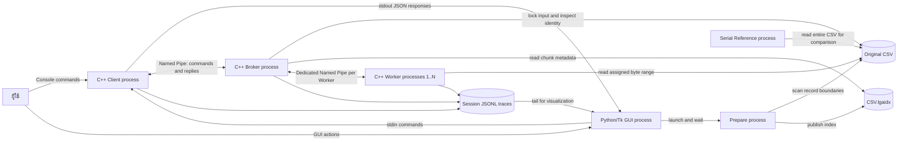

ลูกศรที่ชี้ไปยังไฟล์พร้อมคำว่า read/scan หมายถึง component นั้นเป็นผู้อ่านไฟล์
ลูกศรสองทางของ Named Pipe หมายถึงส่งข้อความได้สองทิศทาง

CSV ไม่ถูกส่งผ่าน Named Pipe ทั้งไฟล์:
TASK ส่ง path, file identity และ byte range; Worker เปิดไฟล์ต้นฉบับเอง
Prepare ไม่ส่ง message ให้ Broker; ทั้งสองใช้ index file เป็นตัวเชื่อม
Reference เป็นเครื่องมือแยกสำหรับตรวจผลและเวลา ไม่อยู่ในเส้นทาง production Job

### 3.2 ใครสร้างใคร และใครถือ state

| Component | ใครเปิด process | State ที่เป็นเจ้าของ |
|---|---|---|
| GUI | ผู้ใช้เรียก Python | Presentation model, process handles ของ session, event queue |
| Client | GUI, test harness หรือผู้ใช้ | Request counter, pending requests, stdin queue, Client pipe |
| Broker | GUI, test harness หรือผู้ใช้ | Jobs, ready-job queue, assignments, aggregate summaries, input locks |
| Worker | GUI, test harness หรือผู้ใช้ | Worker pipe และการคำนวณ TASK ปัจจุบัน |
| Prepare | GUI หรือผู้ใช้/experiments | Input scan และ temporary index จน publish สำเร็จ |
| Reference | ผู้ใช้/tests/experiments | Serial summary ของการเรียกครั้งนั้น |

Broker ไม่ spawn Client/Workers เอง; ต้องมีผู้ใช้, GUI หรือ test harness เปิดให้
Broker กับ Worker แต่ละตัวมี event loop ของตัวเอง
`Common` เป็นชุด source ที่ compile/link เข้า executable แต่ละตัว ไม่ใช่ process เพิ่มและไม่ใช่ shared memory

<a id="s04"></a>
## 4. แผนที่ทุกไฟล์

โครงสร้าง source ปัจจุบัน โดยชื่อที่คั่นด้วย comma หมายถึงไฟล์แยกกันใน directory เดียว:

```text
.
├── README.md
├── AGENT.md, AGENTS.md, Full_Context.md
├── .gitignore
├── .vscode/c_cpp_properties.json
├── Broker/main.cpp
├── Client/main.cpp, gui.py
├── Worker/main.cpp
├── Prepare/main.cpp
├── Reference/main.cpp
├── Common/
│   ├── model.hpp, platform.hpp, event_log.hpp
│   ├── chunks.hpp, chunks.cpp
│   ├── analyzer.hpp, analyzer.cpp
│   ├── message.hpp, message.cpp
│   └── ipc.hpp, ipc.cpp
├── data/small.csv, expected-route.json, expected-time.json
├── scripts/build.ps1, test.ps1, generate.py, experiments.py
├── tests/common_tests.cpp, processes.py, support.py
│         test_gui.py, test_experiments.py
└── MOS/
    ├── buffer-app.rz, scheduler-nextp.rz, observer.c
    ├── run.py, validate_trace.py
    ├── course/mos-rz2.txt
    ├── course/sim21/s21.h, s21.c, load.c, io.c
    ├── tools/rz36.exe, as21.exe
    ├── tests/test_mos.py
    └── riscv/count_errors.c, test_count_errors.c, build.py
```

| ไฟล์/กลุ่ม | หน้าที่และความสัมพันธ์ |
|---|---|
| Broker/main.cpp | ประสานงาน Client/Workers; Job state, scheduling, aggregation และ settlement; ดูบท 10–14 |
| Client/main.cpp | แปลคำสั่ง console, assign request IDs, ตรวจ correlated replies, พิมพ์ JSON; บท 15 |
| Client/gui.py | `ChunkSpan`, `MonitorModel`, `TraceTailer`, `ClusterController`, `MonitorWindow`; บท 16 |
| Worker/main.cpp | READY → รับ TASK → optional test delay → analyze → RESULT → รอ TASK ถัดไป |
| Prepare/main.cpp | รับ CLI, เรียก prepare_index และพิมพ์ index/path/size/chunks/prepare_us |
| Reference/main.cpp | เรียก analyzer เต็มไฟล์; พิมพ์ summary และเขียน timing-file ถ้าระบุ |
| Common/model.hpp | IDs, Analysis/JobState/WorkerState, Counts/Summary และเพดานระบบ |
| Common/platform.hpp | Handle, event, QPC, UTF-8/UTF-16 conversion, JSON escaping, Options, pipe names |
| Common/chunks.hpp/.cpp | FileStamp, LockedInput, RecordReader, header validation, prepare/load index |
| Common/analyzer.hpp/.cpp | Timestamp/CSV validation, analyze/analyze_chunk, merge_summary, summary_json |
| Common/message.hpp/.cpp | Kind/Message, Writer/Reader, encode/decode/Decoder, message_json |
| Common/ipc.hpp/.cpp | Channel และ Operation: connect, read/write, completion, queue, cancel/close |
| Common/event_log.hpp | Trace JSONL ต่อ component และ default trace directory |
| data/small.csv | Input fixture 10 data records พร้อม malformed cases |
| data/expected-route.json, expected-time.json | คำตอบ fixture ที่นับไว้สำหรับ Route/Time แยกจาก parser |
| scripts/build.ps1 | Compile common objects และ link executable ทั้งหกตัว |
| scripts/test.ps1 | Build และเรียก test suites ตามลำดับ; คืนค่า GUI test environment เดิมเมื่อจบ |
| scripts/generate.py | สร้าง CSV ตาม seed, hotspot, burst และ malformed ratio พร้อม metadata |
| scripts/experiments.py | รันจริงเทียบ serial/oracle เก็บ metric/telemetry และ aggregate |
| tests/common_tests.cpp | ทดสอบ parser/index/locking/framing/count limits โดยตรง |
| tests/processes.py | Acceptance suites: transport, concurrency, resources |
| tests/support.py | Cluster, RawWorker, receive/wait helpers, oracle และ process telemetry |
| tests/test_gui.py | Model, trace tailing, real controller processes และ native Tk result view |
| tests/test_experiments.py | ตรวจสูตร fairness, latency boundaries และ partial trace lines |
| MOS/buffer-app.rz | Application Producer/Consumers; compile โดยแทนค่า configuration placeholders |
| MOS/scheduler-nextp.rz | Helper เลือก process แบบไม่ใช้ interrupted frame; แทน nextp ใน generated source |
| MOS/observer.c | สังเกต CPU registers/memory ก่อน/หลัง execution แล้ว emit JSONL |
| MOS/run.py | เตรียม source, compile/assemble, build observed simulator, execute และ validate |
| MOS/validate_trace.py | ตรวจ trace ของ actual simulator; ไม่ schedule process หรือจำลอง Producer เอง |
| MOS/course/mos-rz2.txt | Original MOS kernel พร้อม application เดิม; build ใช้ kernel prefix และ app ใหม่ |
| MOS/course/sim21/s21.h | Opcodes, memory layout, register constants และ declarations ของ S2 |
| MOS/course/sim21/s21.c | CPU registers/memory, instruction execution, traps และ interrupts |
| MOS/course/sim21/load.c | Object loader, IR field decoding, disassembler และ debug display |
| MOS/course/sim21/io.c | Simulated devices/timers; timer ใช้จริง ส่วน waveform/RNG ไม่ใช่ workload นี้ |
| MOS/tools/rz36.exe, as21.exe | Rz compiler และ S2 assembler ที่ต้องมีเพื่อสร้าง object ของ MOS |
| MOS/tests/test_mos.py | Matrix, original-scheduler regression และ corrupt-trace negative test |
| MOS/riscv/count_errors.c | ฟังก์ชัน C นับ status 400–599 ใน array ของ unsigned 32-bit |
| MOS/riscv/test_count_errors.c | Native host assertions ของฟังก์ชันดังกล่าว |
| MOS/riscv/build.py | สร้าง RV32I assembly/object, ตรวจ ELF/instruction classes และรัน native test |
| .vscode/c_cpp_properties.json | IntelliSense GCC, Common include path, C99/C++17; ไม่มีผลเปลี่ยน build script |
| .gitignore | ซ่อน build/, __pycache__, Prepare/generator sidecars และ editor settings ยกเว้น c_cpp_properties.json |
| AGENT.md, AGENTS.md | Working invariants และ startup instructions สำหรับผู้แก้โค้ด |
| Full_Context.md | โจทย์ต้นฉบับ; implementation และข้อจำกัดปัจจุบันอธิบายใน README นี้ |

<a id="s05"></a>
## 5. CSV และผลลัพธ์พร้อมตัวอย่างครบชุด

### 5.1 Input contract

Header ต้องเป็น `timestamp,route,status` ตรงตัว รองรับ UTF-8 BOM ที่ต้นไฟล์
ใช้ LF หรือ CRLF ได้ และ record สุดท้ายไม่จำเป็นต้องลงท้าย newline
หนึ่ง physical line เป็นหนึ่ง record; trailing LF หลัง record สุดท้ายไม่สร้าง record เพิ่ม
รูปแบบเป็นสาม **unquoted fields** ไม่มี CSV quoting, escaping หรือ multiline fields

| Field/เงื่อนไข | กฎ |
|---|---|
| timestamp | `YYYY-MM-DDTHH:MM:SSZ` ยาว 20 ASCII characters, UTC, ปี 1970–9999 |
| วันที่/เวลา | ตรวจ Gregorian leap year, จำนวนวันของเดือน, hour 0–23, minute/second 0–59 |
| route | เริ่มด้วย /, ไม่ว่าง, สูงสุด 256 UTF-8 bytes |
| route ที่ไม่รับ | ASCII whitespace/control (≤0x20), DEL, double quote; comma จะทำให้ field count ผิด |
| status | ตัวเลขสามหลัก 100–599 |
| ความยาว record | สูงสุด 1,024 bytes หลังถอด CR; ไม่รวม LF |
| invalid UTF-8/blank/extra field | นับเป็น malformed หนึ่ง record |
| header ว่าง/ผิด | ทั้ง analysis ล้มเหลว ไม่ใช่ malformed data record |

RecordReader ใช้ read buffer 65,536 bytes และเก็บข้อความต่อบรรทัดไม่เกิน 1,026 bytes
บรรทัดเสียยาวมากยังถูกอ่านทิ้งจนถึง LF เพื่อให้นับ malformed เพียงครั้งเดียว แล้วอ่าน record ถัดไปต่อได้

### 5.2 Aggregation

ทุก valid record เพิ่ม `valid_records`; ทุก malformed data record เพิ่ม `malformed_records`
เฉพาะ status 400–599 จึงเพิ่ม group:
400–499 เพิ่ม 4xx และ 500–599 เพิ่ม 5xx; `errors = 4xx + 5xx`
status 100–399 เป็น valid แต่ไม่สร้าง group

- Route mode: key เป็น route ตามต้นฉบับ
- Time mode: key เป็น UTC minute เช่น `2026-10-11T10:00:00Z`; วินาทีถูกตัดเป็น 00
- Counts เป็น unsigned 64-bit; groups เป็น sorted map จึงแสดง key เรียงลำดับ
- Header-only เป็นงานสำเร็จที่ valid=0, malformed=0, groups ว่าง
- ไม่มี group ที่ errors=0 จาก analyzer ปกติ เช่น /health ที่มีแต่ 204 จะไม่ปรากฏ

### 5.3 ตัวอย่าง fixture ทั้งไฟล์

```csv
timestamp,route,status
2026-10-11T10:00:00Z,/login,200
2026-10-11T10:00:10Z,/login,404
2026-10-11T10:00:59Z,/payment,500
2026-10-11T10:01:00Z,/payment,503
2026-10-11T10:01:10Z,/login,401
2026-10-11T10:01:30Z,/health,204
2026-10-11T10:02:00Z,/payment,400
not-a-record
2026-02-30T10:00:00Z,/login,500
2026-10-11T10:02:30Z,/login,999
```

เจ็ดบรรทัดแรกเป็น valid; สามบรรทัดท้าย malformed เพราะ field count, วันที่ และ status ตามลำดับ
รวม valid=7, malformed=3, errors=5; header ไม่นับเป็น record

Route result:

```json
{
  "valid_records": 7,
  "malformed_records": 3,
  "groups": {
    "/login": {"errors": 2, "4xx": 2, "5xx": 0},
    "/payment": {"errors": 3, "4xx": 1, "5xx": 2}
  }
}
```

Time result:

```json
{
  "valid_records": 7,
  "malformed_records": 3,
  "groups": {
    "2026-10-11T10:00:00Z": {"errors": 2, "4xx": 1, "5xx": 1},
    "2026-10-11T10:01:00Z": {"errors": 2, "4xx": 1, "5xx": 1},
    "2026-10-11T10:02:00Z": {"errors": 1, "4xx": 1, "5xx": 0}
  }
}
```


<a id="s06"></a>
## 6. ข้อมูลใน memory และ ownership

### 6.1 Data dictionary

| Type | ข้อมูล | เจ้าของ/อายุ |
|---|---|---|
| Id | unsigned 64-bit | ใช้เป็น request/job/chunk/worker IDs |
| Analysis | Route=1, Time=2 | อยู่ใน Submit/TASK และ Job |
| Counts | errors, errors4xx, errors5xx เป็น u64 | หนึ่ง aggregation key |
| Summary | valid, malformed และ map(key → Counts) | Worker มี partial; Broker มี aggregate; Reference มีทั้งไฟล์ |
| FileStamp | size, mtime, volume, file_id เป็น u64 | Snapshot ของ input ที่เปิดจริง |
| ChunkRange | begin, end เป็น u64 | ช่วง [begin,end), end ไม่รวมอยู่ใน chunk |
| ChunkIndex | stamp, target_bytes, vector ของ ranges | สร้างโดย Prepare; Broker เก็บใน Job |
| Message | kind, IDs และ fields ตาม kind | หน่วยข้อมูลระดับ application; ดู wire schema บท 9 |
| Channel | Pipe handle, read/write operations, decoder, outgoing frames, counters | หนึ่ง endpoint ของหนึ่ง pipe; ห้าม copy |
| Job | base Submit, state, index, input lock, merge bitmap, counters, summary, timings | อยู่ใน Broker เท่านั้น |
| Worker record | id, Channel, state, current assignment, handshake flags | อยู่ใน Broker; คนละ object กับ Worker process |
| ChunkSpan | Job/chunk/Worker IDs กับเวลา assignment/result/compute/disconnect | Presentation state ของ GUI |

`FileStamp.mtime` มาจาก Windows FILETIME; volume และ file_id ระบุไฟล์ใน volume นั้น
FileStamp ไม่ใช่ hash ของ content
`Message` มี fields รวมทุกชนิดเพื่อใช้โครงสร้างเดียว แต่ wire จะส่งเฉพาะ fields ที่ kind นั้นกำหนด

Utilities ระดับ platform และ serialization:

| Routine/กลุ่ม | Contract |
|---|---|
| Handle get/reset/move/destructor | เจ้าของ handle คนเดียว; move โอน ownership; reset/destructor ปิด handle เดิม |
| event | สร้าง manual-reset Windows event; ใช้ signal/reset กับ wait loop |
| win_error | ใส่ชื่อ operation และ Win32 error code ใน exception |
| ticks/frequency/elapsed_us | อ่าน QPC และแปลง elapsed ticks เป็น microseconds |
| valid_utf8/wide/utf8 | ตรวจ UTF-8 และแปลง UTF-8 ↔ UTF-16 แบบ reject invalid sequences |
| quote_json | Escape quotes, backslashes และ control bytes สำหรับ JSON strings |
| Options constructor/get/number/allow | อ่าน Unicode CLI, lookup defaults, ตรวจ unsigned range และปฏิเสธ unknown keys |
| pipe_name | ตรวจ session characters/length แล้วประกอบชื่อ local endpoint |
| name overloads | แปลง Analysis/JobState/WorkerState/Kind เป็นชื่อสำหรับ JSON/trace/CLI |
| file_stamp/index put/get | อ่าน Windows file metadata และ serialize/deserialize little-endian index integers |
| timestamp/validate_header | ตรวจ calendar timestamp และ exact header หลังถอด BOM/CR |
| Writer num/str/summary | สร้าง payload; ตรวจขนาด/UTF-8/key-count ก่อน framing |
| Reader num/str/summary, analysis, decode | อ่าน payload แบบ bounds-checked และตรวจ semantic fields/trailing bytes |
| encode/Decoder.feed | สร้าง frame และสะสม fragmented/coalesced input เป็น Messages |
| summary_json/message_json | แปลงผลและ application replies เป็น JSON ตาม schemas ในบท 5/9 |
| Input entry/run/enqueue/take | Thread trampoline, bounded stdin reader/queue และ atomic queue handoff ให้ Client loop |

### 6.2 ข้อมูล Job ของ Broker

| Field | ความหมาย |
|---|---|
| base | Submit เดิมที่เพิ่ม Job ID, normalized absolute path และ FileStamp |
| state | Queued/Active/Cancelling/Cancelled/Completed/Failed |
| index, input | ขอบเขต chunk และ LockedInput ที่ถือ read-only file handle |
| merged[i] | รับผล chunk ID i+1 เข้า aggregate แล้วหรือยัง |
| next | Index ของ chunk ถัดไปที่ยังไม่ dispatch; เป็น zero-based |
| completed | จำนวน chunk ที่ผ่าน validation และ merge สำเร็จ |
| in_flight | จำนวน actual assignments ที่ยังไม่ settle |
| summary | ผลจาก chunk ที่รับเข้าแล้วเท่านั้น |
| accepted, first, finished | QPC ticks ตอน admit, first assignment, terminal notification |
| compute_us | ผลรวมเวลา compute ของ chunk ที่ merge สำเร็จ |
| last_progress | QPC boundary ล่าสุดสำหรับ throttle PROGRESS |

ขณะ Job ปกติเป็น Queued/Active:
`total_chunks = completed_chunks + in_flight + pending_chunks`
เมื่อ Cancelling หรือ terminal, pending_chunks=0 เพราะไม่มีสิทธิ์แจกใหม่
จึงไม่ควรใช้สูตรนี้คาดว่าจำนวน chunk ที่ไม่ได้ทำทั้งหมดต้องหายไปเป็น completed

Worker state เริ่ม Disconnected เพราะยังไม่รับ READY;
READY ครั้งแรกที่ identity ถูกต้องเปลี่ยนเป็น Ready;
dispatch เปลี่ยนเป็น Busy; ผลที่ตรง assignment ทำให้กลับ Ready;
pipe/protocol failure เปลี่ยนเป็น Disconnected และไม่มี reconnect

### 6.3 Memory boundaries

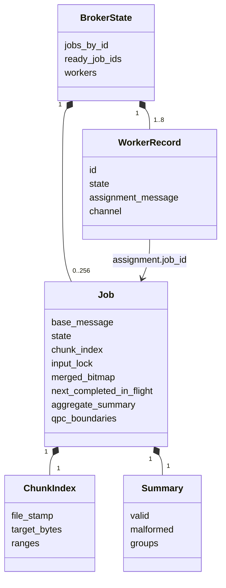

เส้นใน class diagram นี้เป็นความสัมพันธ์ภายใน Broker
Worker process อีกฝั่งมี copy ของ TASK และ partial Summary ของตนเอง ไม่มี pointer มายัง Job ใน Broker

### 6.4 Invariants ที่ห้ามละเมิด

1. ทุก physical data record เป็นของ chunk เดียว และมี valid/malformed accounting ครั้งเดียว
2. Worker มี actual assignment ได้ไม่เกินหนึ่งชิ้น
3. ผลต้องตรง request/job/chunk/Worker IDs ของ assignment ปัจจุบันก่อน release/merge
4. Chunk หนึ่ง merge เข้า aggregate ได้ครั้งเดียว
5. Completed เกิดเมื่อครบทุก validated chunks
6. Late result เปลี่ยน Failed/Cancelled กลับเป็น Completed ไม่ได้
7. คืน Worker/input lock ตาม actual settlement ไม่ใช่เพียงเพราะเปลี่ยน state

<a id="s07"></a>
## 7. Prepare, chunk index และการอ่านไฟล์

### 7.1 ทำไมแยก Prepare

การหา LF boundaries ต้อง scan ไฟล์ทั้งไฟล์ ถ้าทำใน Broker ระหว่าง Submit จะทำให้ event loop
หยุดรับ Status/Cancel และผลของ Worker อื่นตามขนาดไฟล์
จึงให้ Prepare scan ล่วงหน้า แล้ว Broker อ่านเฉพาะ metadata ที่มีขนาดจำกัด
GUI เปิด Prepare บน background workflow จึงยังรับการกดสถานะ/ยกเลิกงานอื่นได้

### 7.2 ขั้นตอน prepare_index

1. ตรวจ target_bytes อยู่ใน 1..8 GiB แล้วเปิด LockedInput
2. อ่าน header และตรวจ dialect
3. เดิน physical lines ด้วย RecordReader โดยนับ byte position รวม LF
4. เมื่อระยะจาก begin ถึงท้าย record ปัจจุบันถึง target จึงปิด chunk ที่ตำแหน่งนั้น
5. เพิ่ม chunk สุดท้ายถ้ามี bytes เหลือ; header-only ยังได้หนึ่ง chunk
6. จำกัดไม่เกิน 65,536 chunks และตรวจ FileStamp อีกครั้ง
7. เขียน temporary sidecar ชื่อมี process ID/QPC แล้ว flush/close
8. Publish ด้วย MoveFileExW แบบ replace + write-through; ถ้าพลาดลบ temporary แล้วรายงาน error

Target เป็นเป้าหมายขนาด ไม่ใช่ขนาดตายตัว:
chunk อาจใหญ่กว่า target เพราะต้องรอ LF และห้ามตัดกลาง record
Chunk แรกเริ่มที่ byte 0 รวม header; analyzer เป็นผู้ข้าม header เมื่อเริ่มอ่าน data
Index ไม่เก็บเนื้อหา CSV และไม่สร้างไฟล์แยกต่อ chunk

### 7.3 รูปแบบ sidecar

ชื่อไฟล์คือ `<CSV path>.lgaidx` เช่น `build/demo.csv.lgaidx`
ทุกจำนวน little-endian:

| Byte offset | Field | ขนาด |
|---:|---|---:|
| 0 | Magic ASCII LGI2 = 0x3249474c | 4 |
| 4 | Version=1 | 4 |
| 8 | File size | 8 |
| 16 | File mtime | 8 |
| 24 | Volume serial | 8 |
| 32 | File ID | 8 |
| 40 | Target bytes | 8 |
| 48 | Chunk count N | 8 |
| 56 เป็นต้นไป | N คู่ begin/end | คู่ละ 16 |

ขนาดทั้งหมดต้องเป็น `56 + 16*N` bytes, N=1..65,536
ช่วงต้องเรียงต่อกันจาก 0 ถึง EOF, ห้าม gap/overlap/empty range
header มากสุด 56 bytes + ranges มากสุด 1 MiB
คำว่า version=1 ของ index เป็นคนละ version กับ IPC wire v2

### 7.4 load_index และ fallback

Broker เปิด lock ของ CSV ก่อนอ่าน index และเปรียบเทียบ FileStamp ทุก field
ตัว metadata ถูกเปิดแบบ locked read ด้วยเพื่อไม่ให้ Prepare เปลี่ยนไฟล์กลาง admission
ตรวจ size/magic/version/target/count/coverage; Worker ตรวจ header และ LF boundaries อีกครั้งตอนทำ TASK

- มี index แต่ stale/เสีย: reject ไม่ fallback เงียบ ๆ
- ไม่มี index และ input ≤8 MiB: ใช้ single chunk [0,size) โดยยังไม่ scan header ตอน admission
- ไม่มี index และ input >8 MiB: reject พร้อมให้รัน Prepare
- Copy/edit ไฟล์อาจเปลี่ยน identity/mtime ต้อง Prepare ใหม่เมื่อ index ไม่ตรง

จึงมีกรณีไฟล์เล็ก header ผิดที่ได้รับ ACCEPTED ก่อน แล้ว Worker ส่ง failure ภายหลังได้
ACCEPTED หมายถึงรับ Job ไม่ได้ยืนยันว่า parse ทั้งไฟล์ผ่านแล้ว

### 7.5 LockedInput และ analyzer

LockedInput เปิด CreateFileW ด้วย GENERIC_READ และ FILE_SHARE_READ เท่านั้น
ยอมให้ Workers เปิดอ่านพร้อมกัน แต่ปฏิเสธ writers/deletion ที่ขัดกับ share mode
Broker ถือ handle จน Job settled แม้ส่ง FAILED ไปแล้ว
Worker เปิด read handle ของตัวเอง ตรวจ identity ก่อนอ่านและตรวจ stamp หลังอ่าน

`read_at` ใช้ SetFilePointerEx/ReadFile แบบ synchronous ภายใน process เจ้าของ handle
จึงไม่ใช้ handle เดียวกันข้าม Worker processes หรือให้หลาย threads เปลี่ยน file pointer พร้อมกัน
Overlapped I/O ของโปรเจกต์ใช้กับ pipes ไม่ได้ทำให้การอ่าน disk ของ Worker เป็น asynchronous

`analyze` อ่านทั้งไฟล์สำหรับ Reference; `analyze_chunk` อ่านช่วง TASK และตรวจ FileStamp
ทั้งสองเรียก parser เดียวกัน
ก่อนอ่าน chunk ตรวจว่า begin/end ที่ไม่ใช่ 0/EOF มี LF ก่อน boundary และไม่ตัดกลาง header

<a id="s08"></a>
## 8. Named Pipes และ Overlapped I/O

### 8.1 Topology และชื่อ endpoint

Broker เป็น pipe server ทุกเส้น, Client/Worker เป็น pipe clients

| Endpoint | ชื่อ Windows pipe |
|---|---|
| Client ↔ Broker | `\\.\pipe\lga_<session>_client` |
| Worker 1 ↔ Broker | `\\.\pipe\lga_<session>_worker` |
| Worker 2..N ↔ Broker | `\\.\pipe\lga_<session>_worker2` ... `workerN` |

Session ยาว 1–48 characters รับเฉพาะ A–Z, a–z, 0–9, dash และ underscore
แต่ละ pipe เป็น local duplex byte stream, หนึ่ง instance, buffer 4,096 bytes
ใช้ FILE_FLAG_OVERLAPPED, FILE_FLAG_FIRST_PIPE_INSTANCE และ PIPE_REJECT_REMOTE_CLIENTS
Worker ทุกตัวมี pipe ของตนเอง ไม่มี Worker↔Worker pipe

Client-side open ลองเปิด endpoint ภายใน 5 วินาทีเพื่อรองรับ startup race
นี่เป็นการรอเชื่อมต่อเริ่มต้น ไม่ใช่ reconnect หลัง session ล้มเหลว

### 8.2 การทำงานของ Channel

| Routine/ส่วน | หน้าที่ |
|---|---|
| Constructor | สร้าง server และ pending ConnectNamedPipe หรือเปิด client endpoint แล้วเริ่ม read |
| Operation.reset | Reset event/OVERLAPPED; เตรียม active/pending/bytes ของ operation ใหม่ |
| begin_read | ReadFile ลง stable 4 KiB buffer; synchronous completion ก็ signal event |
| begin_write | WriteFile จาก frame หน้าคิว; เริ่มได้เมื่อไม่มี write ที่ active |
| finish | ตรวจ event แล้ว GetOverlappedResult เมื่อเป็น pending; collect bytes/error |
| pump | เก็บ write completion ก่อน read completion, decode messages, เริ่ม I/O ถัดไป |
| send | Encode, ตรวจ queue bounds, เก็บ frame แล้วเริ่ม write |
| append_events | เพิ่ม active read/write events ลง wait set |
| stop_receiving | หยุด read, CancelIoEx/collect pending read ก่อน drain final write |
| close | Cancel/collect pending read และ write แล้วปิด pipe; เรียกซ้ำได้ |
| wait_events | WaitForMultipleObjects แบบ wait-any; ปฏิเสธ wait set ว่าง/ใหญ่เกิน OS limit |

แยก read/write OVERLAPPED และ event คนละชุด
Win32 อาจยังถือ pointer เข้า buffers/OVERLAPPED หลัง API return
จึงต้องให้ Channel อยู่ address เดิม และเก็บ outgoing frame จนเขียนครบ
Broker เก็บ Worker records ผ่าน unique_ptr เพื่อรักษา object address เมื่อ vector โต

การส่งครั้งเดียวอาจเขียนไม่ครบ frame: write_offset เดินต่อจนหมด
การอ่านครั้งเดียวอาจได้ครึ่ง frame หรือหลาย frames: Decoder เก็บส่วนที่ยังไม่ครบ
การ cancel I/O ต้อง collect completion ก่อนทำลาย buffer ไม่ใช่ CancelIoEx แล้ว free ทันที

`send` หมายถึงนำ frame เข้าคิวสำเร็จ ยังไม่รับประกัน peer รับแล้ว
`drained` หมายถึง local outgoing queue เขียนครบ ไม่ใช่ application ACK จาก peer
ตอนปิดเชื่อมต่อจึงใช้ทั้ง protocol acknowledgement และการ drain ให้ถูกลำดับ

### 8.3 Backpressure

แต่ละ Channel จำกัด outgoing 64 frames และ bytes รวมไม่เกิน `4*(2 MiB+12)`
Decoder จำกัด payload 2 MiB และ receive buffering ไม่เกิน `2*(2 MiB+12)`
หาก queue เต็มจะเกิด exception แทนการโตไม่จำกัด

Broker ส่ง intermediate PROGRESS เมื่อ client queue น้อยกว่า 8 frames
และห่างจากครั้งก่อนอย่างน้อยประมาณ 50 ms/Job
ทุก merge ยังถูกเขียน trace แม้ไม่ได้ส่ง PROGRESS
STATUS และ terminal replies ไม่ใช้ progress throttle
ถ้า final enqueue ไม่ได้ Broker ปิด Client connection, cancel งานที่ยังไม่จบ และ settle assignments

<a id="s09"></a>
## 9. Protocol: ทุก message และ field order

### 9.1 Frame header และ primitive types

Protocol ปัจจุบันคือ **wire v2**; ทุก frame มี header 12 bytes:

| Offset | Field | Type/value |
|---:|---|---|
| 0 | Magic | 4 bytes ASCII LGA1 = 0x3141474c |
| 4 | Version | u16=2 |
| 6 | Kind | u16=1..16 |
| 8 | Payload length | u32 ≤2 MiB |
| 12 | Payload | Fields ตามตารางด้านล่าง |

`u8/u16/u32/u64` หมายถึง unsigned integers 1/2/4/8 bytes แบบ little-endian
`str` คือ u32 byte length ตามด้วย UTF-8 bytes; ห้าม NUL และ invalid UTF-8
ไม่มี padding ระหว่าง fields และไม่มี terminating NUL
Decoder ปฏิเสธ unknown kind/version, invalid enum/bool, truncated fields และ trailing bytes

Summary บน wire มีลำดับ:
`valid:u64, malformed:u64, key_count:u32` แล้วทำซ้ำ
`key:str, errors:u64, errors4xx:u64, errors5xx:u64`
key_count ≤4,096, key ยาว 1..256 bytes, ห้าม key ซ้ำ
ผลรวม errors ต้องไม่เกิน valid และทุก key ต้องมี 4xx+5xx=errors

### 9.2 Message catalog

ลำดับในคอลัมน์ Payload คือ byte order จริง; fields ที่ไม่เขียน type เป็น u64

| Kind | ชื่อ / ทิศทาง | Payload ตามลำดับ |
|---:|---|---|
| 1 | READY: Worker → Broker | worker |
| 2 | SUBMIT: Client → Broker | request, analysis:u8, path:str |
| 3 | ACCEPTED: Broker → Client | request, job, total_chunks |
| 4 | REJECTED: Broker → Client | request, reason:str |
| 5 | TASK: Broker → Worker | request, job, chunk, worker, analysis:u8, path:str, begin, end, file_size, file_mtime, file_volume, file_id |
| 6 | RESULT: Worker → Broker | request, job, chunk, worker, success:u8, reason:str, duration_us, summary |
| 7 | STATUS_REQUEST: Client → Broker | request, job |
| 8 | STATUS: Broker → Client | request, job, state:u8, worker_state:u8, total_chunks, completed_chunks, in_flight, pending_chunks, monitor:str |
| 9 | COMPLETED: Broker → Client | เหมือน RESULT schema; summary เป็นผลรวมทั้ง Job |
| 10 | FAILED: Broker → Client | เหมือน RESULT schema; success=false, reason ระบุสาเหตุ |
| 11 | SHUTDOWN: Client → Broker หรือ Broker → Worker | request |
| 12 | SHUTDOWN_ACK: Worker → Broker หรือ Broker → Client | request |
| 13 | CANCEL: Client → Broker | request, job |
| 14 | CANCEL_ACK: Broker → Client | เหมือน STATUS schema |
| 15 | CANCELLED: Broker → Client | เหมือน STATUS schema |
| 16 | PROGRESS: Broker → Client | เหมือน STATUS schema |

Enums: Analysis Route=1/Time=2; JobState Queued=1, Active=2, Cancelling=3, Cancelled=4,
Completed=5, Failed=6; WorkerState Ready=1, Busy=2, Disconnected=3; success=0/1
Progress schema ตรวจ completed≤total, in_flight≤total-completed
และ pending≤total-completed-in_flight

### 9.3 Identity และ request lifecycle

- Client ส่ง request IDs เริ่ม 1 และเพิ่มเฉพาะ command ที่ส่งจริง
- Broker บังคับ positive และเพิ่มอย่างเคร่งครัดตลอด connection; ผิดถือเป็น protocol failure
- Broker แจก Job IDs เริ่ม 1 เมื่อรับ Submit สำเร็จ
- Chunk IDs เริ่ม 1 ภายใน Job; Worker IDs อยู่ 1..configured Workers
- READY ไม่มี request ID บน wire; request=0 ของ internal Worker shutdown เกิดได้เมื่อ Client loss/OS control stop
- ACCEPTED, PROGRESS, COMPLETED/FAILED/CANCELLED ของ Job ใช้ request ID ของ Submit เดิม
- CANCEL_ACK ใช้ request ID ของ Cancel ไม่ใช่ Submit
- Status ทั้งระบบใช้ job=0; Status เฉพาะ Job ใช้ positive Job ID

Client เก็บ request ไว้ pending หลัง ACCEPTED/PROGRESS
จึงยังรอ terminal reply ของ Submit ต่อ
REJECTED/STATUS/CANCEL_ACK/COMPLETED/FAILED/CANCELLED/SHUTDOWN_ACK ทำให้ request นั้นหลุด pending

### 9.4 Client stdout กับ binary wire ต่างกันอย่างไร

GUI อ่าน JSON lines ที่ Client สร้างจาก message หลัง decode ไม่ได้อ่าน binary frame เอง
JSON response ทุกตัวมี type, request_id, job_id, chunk_id, worker_id
ACCEPTED เพิ่ม total_chunks; FAILED/REJECTED เพิ่ม reason
COMPLETED เพิ่ม worker_compute_us และ summary
STATUS/PROGRESS/CANCEL_ACK/CANCELLED เพิ่ม job_state, worker_state, counters และ monitor object

ตัวอย่าง terminal response แบบสมบูรณ์:

```json
{
  "type": "COMPLETED",
  "request_id": 1,
  "job_id": 1,
  "chunk_id": 0,
  "worker_id": 0,
  "worker_compute_us": 1234,
  "summary": {
    "valid_records": 2,
    "malformed_records": 0,
    "groups": {"/login": {"errors": 1, "4xx": 1, "5xx": 0}}
  }
}
```

ตัวเลขเป็นตัวอย่างรูปแบบ ไม่ใช่ benchmark result
chunk_id/worker_id=0 ใน aggregate reply เพราะไม่ได้แทน Worker/chunk ใดโดยเฉพาะ
FAILED มี partial summary ใน binary schema แต่ Client JSON แสดง reason และไม่เผยแพร่เป็น successful result
CANCELLED JSON แสดงสถานะ/counters; ไม่มี completed summary

<a id="s10"></a>
## 10. Broker: admission, event loop และ aggregation

### 10.1 Startup และ admission

Broker อ่าน options, ตรวจ policy/io-mode/ranges, สร้าง Client pipe และ Worker pipes
ตั้ง console control handler ที่ทำเพียง signal stop event แล้วพิมพ์ BROKER_READY
ยังไม่ต้องรอทุก Worker READY จึงสามารถ admit Job ก่อน Worker เชื่อมครบได้

Submit ถูก reject เมื่อ:
Broker stopping, nonterminal jobs ถึง capacity, ทุก Worker channel ปิดแล้ว,
path ไม่ใช่ regular file, เปิด stable read lock ไม่ได้,
ไฟล์เกิน 8 GiB, index หายสำหรับไฟล์ใหญ่, index invalid/stale หรือ history ไม่มีที่ว่าง

เมื่อผ่าน admission:
เก็บ normalized absolute path, lock, index/stamp, merged bitmap และ accepted QPC
เพิ่ม Job ลง map กับ Job ID ใหม่, เพิ่ม ID ท้าย ready queue และส่ง ACCEPTED

Capacity นับ Queued/Active/Cancelling; Failed เป็น terminal แม้ยังมี in-flight
แต่ Job ที่ Failed และยังไม่ settled ต้องถือ lock/assignment ต่อ
History เก็บได้ 256 Job records; เมื่อเต็มจะลบ Job ID ต่ำสุดที่เป็น terminal และไม่มี in-flight
ถ้าลบไม่ได้จะ reject งานใหม่ ไม่ลบ active state เพื่อให้รับงานเพิ่ม

### 10.2 หนึ่งรอบ event loop

| ลำดับ | งาน |
|---:|---|
| 1 | รับ control stop event และ pump Client commands โดยไม่รอ Worker compute |
| 2 | Pump Worker channels, ตรวจ READY/RESULT/ACK และ settle failures |
| 3 | Dispatch ตาม ready queue ไปยัง Ready Workers เรียง Worker records |
| 4 | ถ้า stopping และทุก Job settled ให้ทำ shutdown handshake |
| 5 | รวม I/O/control events แล้ว wait-any จนมีเหตุการณ์ใหม่ |

Async mode รอ event จาก Client และทุก Worker
Sequential-wait เป็น baseline ทดลอง: ถ้ามี Busy Worker จะรอเฉพาะ Worker แรกที่ Busy กับ stop event
code รอบถัดไปยัง pump ทุก channel แต่โอกาสตื่นมารับคำสั่งอาจช้าลง
จึงใช้แสดงผลของ head-of-line waiting ไม่ได้เปลี่ยน pipe เป็น synchronous API

### 10.3 เมื่อ RESULT มาถึง

1. Log result_received ซึ่งเป็นเพียง **รับข้อความ** ยังไม่ได้ยืนยันว่าผลถูกต้อง
2. ตรวจ Worker Busy และ request/job/chunk/worker ตรง assignment ปัจจุบัน
3. ตรวจ chunk index และ merged bitmap ว่ายังไม่เคยรับ
4. ลด in_flight และคืน Worker เป็น Ready พร้อมล้าง assignment
5. ถ้า Job ยัง Active: ตรวจ success, record counts ไม่เกิน chunk bytes และ duration ไม่ overflow
6. merge_summary ตรวจทุก count/key/overflow ก่อนเพิ่ม counts เข้า destination
7. Mark merged, เพิ่ม completed/compute_us และ log chunk_merged
8. ถ้าครบทุก chunk เปลี่ยน Completed และส่ง final; ไม่ครบอาจส่ง throttled PROGRESS
9. ถ้า Job Cancelling/Failed อยู่แล้ว ให้ discard summary ของ late result และ settle อย่างเดียว
10. เรียก settle เพื่อเปลี่ยน Cancelling→Cancelled หรือปล่อย lock เมื่อ terminal และ in_flight=0

merge_summary ตรวจ capacity/count overflow ทุกตัวก่อนเริ่มบวกข้อมูล
validation failure จึงไม่ยอมรับ chunk บางส่วนเข้า aggregate
ข้อผิดพลาดการคำนวณใน Worker ทำให้ Job Failed แต่ Worker ยัง reuse ได้
ผิด assignment/duplicate/protocol ทำให้ channel ของ Worker ถูกตัด เพราะไม่ควรเชื่อถือผลต่อไป

### 10.4 Internal helpers ของ Broker

| Routine | หน้าที่ |
|---|---|
| interrupt | Console callback signal stop event โดยไม่แก้ Job state ใน callback |
| terminal, Job.settled, Job.pending_chunks | นิยาม state/resource และ dispatch eligibility |
| reply/reject | ส่ง correlated response หรือจัดการ delivery failure |
| fill_progress | คำนวณ counters และภาพรวม worker_state ของ Job |
| snapshot | สร้าง monitor JSON จาก state จริง |
| remove_ready | เอา Job ID ออกจาก dispatch queue |
| notify_terminal | เก็บ terminal ticks, เอาออก ready, ส่ง final และ log |
| settle | เปลี่ยน Cancelled หลัง in-flight หมด และคืน input lock |
| fail/cancel | เปลี่ยน Job state โดยไม่คืน assignment ที่ยังทำงาน |
| lose_worker | ปิด channel, settle assignment ที่ถือจริง และ fail affected Job |
| settle_disconnect | Client loss → stopping + cancel งานที่ไม่ terminal |

### 10.5 Monitor snapshot schema

STATUS ส่ง snapshot ทั้งระบบใน monitor แม้คำขอจะระบุ Job ID:

| ระดับ | Fields |
|---|---|
| System | policy, io_mode, capacity, ready_jobs, jobs, workers, qpc_ticks, qpc_frequency, ipc_messages, ipc_bytes |
| Job item | job_id, request_id, path, analysis, state, total_chunks, completed_chunks, in_flight, pending_chunks, valid_records, malformed_records, accepted_ticks, first_assignment_ticks, terminal_ticks |
| Worker item | worker_id, state, job_id, chunk_id; ไม่มี assignment ใช้ Job/chunk=0 |

Job valid/malformed ใน snapshot เป็น partial ที่ merge แล้ว ไม่ใช่ผลสุดท้ายถ้า Job ยังไม่ Completed
worker_state ระดับ response เป็นภาพรวมแบบ Busy ถ้ามี Worker ถือ Job นี้,
ไม่เช่นนั้น Ready ถ้ามี Worker ว่างสักตัว, นอกนั้น Disconnected
อย่าใช้ field เดียวนี้แทนรายการ workers ใน snapshot
STATUS ทั้งระบบ job=0 มี scalar state/counters เป็นค่าเริ่มต้น; ให้ใช้ monitor เป็นข้อมูลจริง
PROGRESS/CANCEL_ACK/CANCELLED ปกติมี monitor={} จึงไม่ใช่ authoritative whole-system snapshot


<a id="s11"></a>
## 11. FIFO/Round-robin พร้อมตัวอย่าง

Ready queue เก็บ **Job IDs ที่ยังมี chunk ให้แจก** ไม่ได้เก็บไฟล์ chunk หรือ OS threads
Broker หยิบหัวคิวเมื่อมี Ready Worker; ไม่ interrupt งานที่ Worker กำลัง compute

| Policy | หลังแจก chunk ให้ Worker |
|---|---|
| fifo | คง Job ที่หัวคิวจนแจก chunk ของ Job นั้นหมด แล้วค่อยเอาออก |
| rr | เอา Job ออกจากหัวคิว และถ้ายังมี chunk ให้เอาไปต่อท้าย |
| ทั้งสอง | ไม่เอา Job ที่ไม่มี pending กลับคิว; ผลกลับเมื่อใดก็ตรวจและ merge เมื่อนั้น |

ตัวอย่างที่ admission เสร็จทั้งหมดก่อนเริ่ม dispatch และใช้ Worker เดียว:
A มี 3 chunks, B มี 2, C มี 1

```text
เริ่ม ready = [A, B, C]
FIFO dispatch: A1 → A2 → A3 → B1 → B2 → C1
RR dispatch:   A1 → B1 → C1 → A2 → B2 → A3
```

เมื่อใช้หลาย Workers ผลการจบไม่ต้องเป็นลำดับเดียวกับ dispatch
FIFO หมายถึงแจก chunks ของ A ก่อน B ไม่ได้บังคับให้ A ต้อง Completed ก่อน B
เช่น A แจกหมดแล้วแต่ชิ้นสุดท้ายยังช้า, Worker ว่างอีกตัวเริ่มและจบ B ได้ก่อน
RR แบ่งโอกาสระดับ chunk ไม่รับประกัน CPU time/bytes เท่ากัน เพราะ chunk/record size และ parse cost ต่างกัน

<a id="s12"></a>
## 12. Sequence ของงานสำเร็จและผลที่กลับไม่เรียงกัน

### 12.1 Prepare → Submit → Completed

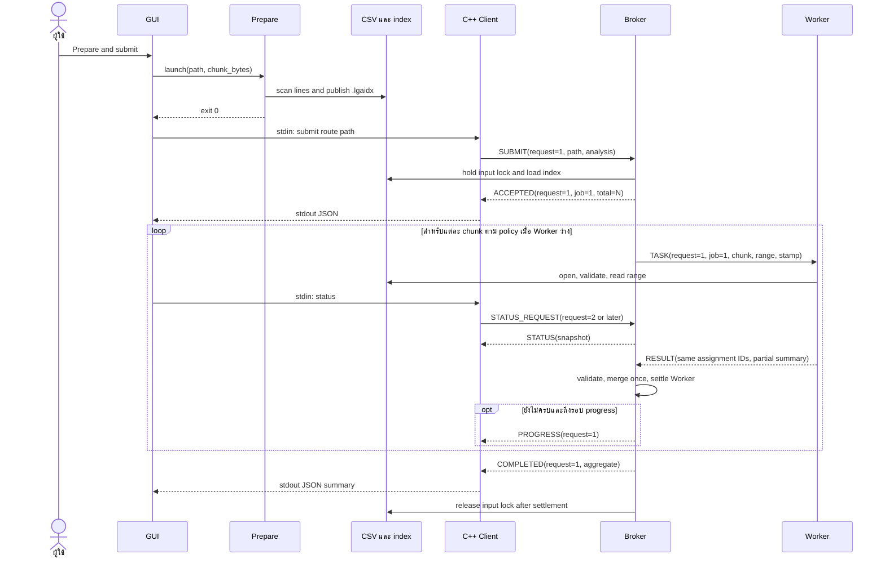

Status ใน loop เป็นการแสดงว่าแทรกได้ ไม่ได้ส่ง Status ทุก chunk โดยอัตโนมัติ
Worker ไม่ส่ง PROGRESS ให้ Client โดยตรง
Prepare time เกิดก่อน command_started ของ Submit จึงไม่รวมใน admission/turnaround metrics

### 12.2 Out-of-order walkthrough

สมมติ Job 10 มี C1,C2,C3 และ Workers W1,W2,W3:

| เหตุการณ์ | completed | in_flight | merged ที่เป็น true |
|---|---:|---:|---|
| Dispatch ครบสามชิ้น | 0 | 3 | ไม่มี |
| W2 ส่ง C2 ถูกต้อง | 1 | 2 | C2 |
| W3 ส่ง C3 ถูกต้อง | 2 | 1 | C2,C3 |
| W1 ส่ง C1 ถูกต้อง | 3 | 0 | C1,C2,C3 |

Map counts บวกกันได้โดยไม่ต้องจัดผลใหม่ตาม chunk ID
แต่ทุก result ต้องระบุ Job/chunk/Worker ที่ตรง assignment ก่อนบวก
ถ้า replay C2 ในขณะ W2 ถือ C4 อยู่จะไม่ถูกยอมรับให้ปล่อย C4
ผิด identity จะตัด Worker channel และ settle งานที่ Worker ถือจริงตาม failure path

<a id="s13"></a>
## 13. State machine, cancellation และ failure

### 13.1 Job state

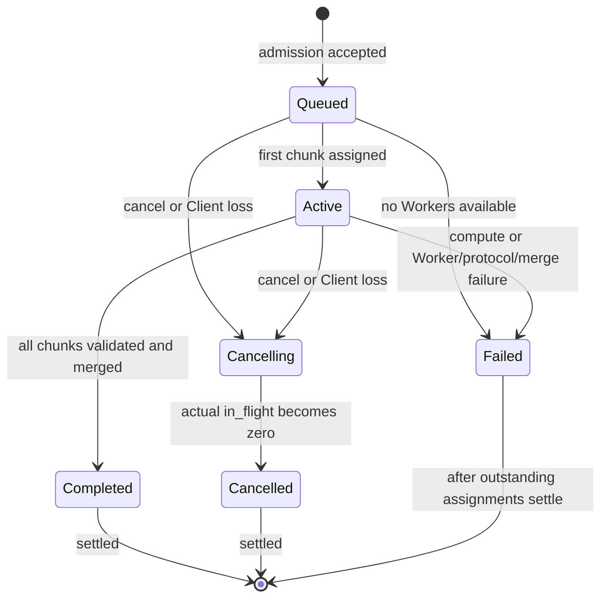

Rejected ไม่ใช่ Job state เพราะคำขอนั้นไม่ได้สร้าง Job ที่รับเข้าระบบ
Active อาจยังไม่มี pending chunks เพราะแจกหมดแล้วแต่กำลังรอผล
Failed ส่ง terminal response ได้ทันทีที่ทราบ failure แม้ Worker ตัวอื่นยังไม่ส่งผล
จึงต้องแสดง `state=Failed, in_flight>0` ได้อย่างถูกต้อง

### 13.2 Cancellation ที่ขอบ chunk

สมมติ Submit ใช้ request=1, Cancel ใช้ request=2:

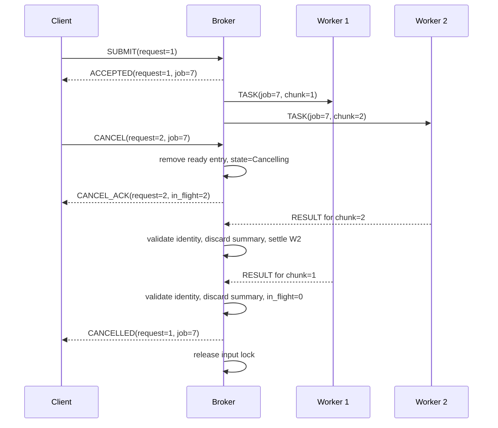

CANCEL_ACK ยืนยันรับคำสั่ง ไม่ได้แปลว่า Worker หยุดแล้ว
Worker ไม่มี CANCEL message และไม่ถูกฆ่ากลาง parser; ทำ chunk ปัจจุบันให้จบ
queued Job ที่ยังไม่มี assignment จะส่ง Cancelled ได้ทันทีหลัง CancelAck
Cancel ซ้ำระหว่าง Cancelling ยังคงรอ settlement; Cancel terminal Job ถูก reject

ถ้า Worker หลุดหลังรับ Cancel ให้ settle assignment นั้นผ่าน disconnect path
Job ยังเป็น Cancelling จน in-flight ทั้งหมดหมดแล้วเป็น Cancelled
fail helper ไม่เปลี่ยน Cancelling เป็น Failed

### 13.3 Failure matrix

| เหตุการณ์ | ผลกับ Job/ระบบ |
|---|---|
| malformed data record | เพิ่ม malformed แล้วอ่านต่อ; งานอาจ Completed ได้ |
| bad/missing header, wrong chunk boundary หรือ stamp | Worker ส่ง RESULT success=false; Job Failed |
| aggregate เกิน 4,096 keys/count หรือ compute duration overflow | Job Failed; ไม่ยอมรับ chunk นั้นเข้า summary |
| Worker process/pipe หลุดขณะ Busy | ลด actual in-flight ของ assignment นั้น, fail affected Job |
| ผลผิด assignment/duplicate READY/duplicate result | Protocol failure → Worker disconnected; ไม่ merge ผลผิด |
| ผลของ Job Failed/Cancelling ที่ยังตรง assignment | คืน assignment แต่ discard counts; ไม่ revive Job |
| ทุก Worker channel ปิด | Fail งานที่ยังไม่ terminal และ reject Submit ใหม่ |
| Client หลุด/ส่งผิด protocol | Broker stopping, cancel งานที่ยังไม่ terminal, settle แล้ว shutdown Workers |
| ส่ง response ไม่ได้เพราะ backpressure/connection | ทำ Client disconnect path อย่างชัดเจน |
| GUI process เห็น Client/Broker exit | เริ่ม stop workflow สำหรับ processes ของ controller นี้ |

Worker loss ไม่ reschedule chunk ที่หายไป เพราะไม่มี retry semantics
Workers ที่เหลือยังทำ Job อื่นหรือ Job ใหม่ได้หลัง Job ที่เสียถูก settle
ถ้า Worker ขาดเพียงบางตัว readiness ใน snapshot ต้องสะท้อนจำนวนที่เหลือจริง

<a id="s14"></a>
## 14. Shutdown และการคืน resources

### 14.1 วิธีหยุดมี semantics ต่างกัน

| วิธี | การจัดการ Job |
|---|---|
| Client `shutdown` | รับได้เมื่อทุก Job settled เท่านั้น; ขณะยังค้างจะ REJECTED |
| Client `quit`/stdin EOF | หยุดรับคำสั่งใหม่ รอ pending replies และ outgoing แล้ว Client exit |
| Broker Ctrl+C/Ctrl+Break/console close | Callback signal event; Broker stop admission แล้ว drain งานที่ admit แล้ว |
| Client หลุดกะทันหัน | Broker cancel งานที่ยังไม่ terminal, รอ actual settlement แล้วหยุด |
| GUI Stop/ปิดหน้าต่าง | ขอ cancel งานที่ model รู้ว่ายังไม่ terminal แล้วส่ง quit; รอ child processes |

GUI ให้เวลา graceful stop 8 วินาที แล้ว terminate เฉพาะ Popen processes ที่ controller นี้เปิด
ถ้ารอ terminate ไม่จบภายใน 2 วินาทีจึง kill แล้วรออีกครั้ง
ไม่มีการค้นชื่อ process แล้วฆ่า session อื่น

### 14.2 Idle shutdown handshake

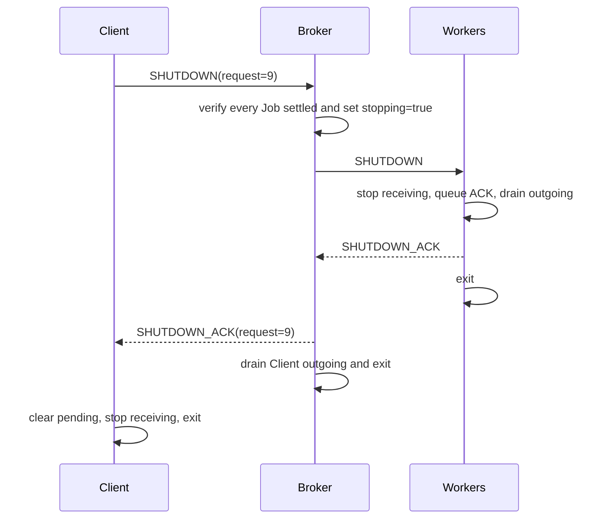

Broker เผื่อ startup handshake 1.5 วินาทีสำหรับ Worker ที่ยังไม่ READY
เมื่อพ้นเวลาจึงปิด endpoint ที่ไม่ได้เชื่อมพร้อม
เวลานี้ไม่ใช่ timeout ของ chunk computation
Worker ที่ READY และรับ SHUTDOWN แล้วต้อง ACK; ไม่มี timeout รวมสำหรับ Worker ที่ค้างแต่ pipe ยังไม่หลุด

### 14.3 Resource lifetime

Handle ปิดด้วย RAII; LockedInput คืนเมื่อ settled
Channel ต้อง cancel/collect pending I/O ก่อนคืน buffers/OVERLAPPED
Client ใช้ CancelSynchronousIo ปลด stdin helper ที่บล็อกตอน destructor
การปิด read ก่อน drain ACK ช่วยไม่ให้ EOF จาก peer ที่ exit เร็วกลบ final write completion

Signal stop event เป็นการสื่อสารระหว่าง callback กับ main loop
state mutation ของ Broker ยังอยู่บน main loop เพียงจุดเดียว
Stop/cancel state ไม่ได้แทน OS I/O cancellation; CancelIoEx ใช้จัดการ operation ของ pipe ไม่ได้ cancel Job

<a id="s15"></a>
## 15. C++ Client และ command interface

Client มี main event loop และ helper thread หนึ่งตัวที่อ่าน stdin แบบ blocking
helper อ่านทีละ 512 bytes, แยก LF, ถอด CR, ตรวจขนาดต่อ command ≤8,192 bytes
และคิวไม่เกิน 128 commands แล้ว signal ready event ภายใต้ mutex
main thread take queue, EOF และ error พร้อมกันแล้ว reset event ภายใต้ mutex เดียวกัน

Main loop pump Broker replies ก่อน, ตรวจ request ว่ายัง pending, พิมพ์ JSON แล้ว update pending
จากนั้นอ่าน commands ที่ helper ส่งมา, validate/encode/send แล้วเพิ่ม request counter
ถ้าไม่มีงาน I/O พร้อมจะ wait pipe events และ stdin-ready event

| คำสั่ง | ผล |
|---|---|
| `submit route "FILE"` | แปลง path เป็น absolute/normalized UTF-8 แล้ว SUBMIT Route |
| `submit time "FILE"` | SUBMIT Time |
| `status` | STATUS_REQUEST job=0 ทั้งระบบ |
| `status JOB_ID` | ขอ counters ของ Job นั้นพร้อม whole-system snapshot |
| `cancel JOB_ID` | CANCEL; Job ID ต้องเป็น positive decimal |
| `shutdown` | ขอหยุด Broker/Workers เมื่อ idle |
| `quit` | หยุดรับ commands และ drain; ไม่ส่ง wire QUIT |
| `help` | พิมพ์คำสั่ง; ไม่สร้าง request |

Windows backslashes ใน path เป็น literal; path มีช่องว่างให้ครอบ double quotes
command ที่ไม่รู้จัก/argument เกิน/analysis ผิด พิมพ์ command error และยังรับคำสั่งต่อ
command error ไม่ใช้ request ID ใหม่
input ใหญ่เกิน/queue เต็ม พิมพ์ input error แล้ว drain คำขอที่ส่งไปก่อนแล้วจบ
EOF รองรับ command สุดท้ายที่ไม่มี LF และรักษาขอบเขต 8,192 bytes เช่นเดียวกัน

stdout มีได้ทั้ง help/banner, command error/input error และ JSON
หลังส่งคำสั่งจะมี JSON local event เช่น:

```json
{"event":"command_sent","request_id":1,"type":"SUBMIT"}
```

บรรทัดนี้เป็น acknowledgement ภายใน Client ว่า queue ส่งสำเร็จ
แยกจาก ACCEPTED ซึ่งมาจาก Broker
GUI จึง parse เฉพาะ JSON object และแสดง text อื่นเป็น console events

<a id="s16"></a>
## 16. GUI, threads และ timeline

### 16.1 โครงสร้างภายใน

| Class | ข้อมูล/หน้าที่ | Methods ที่ควรรู้ |
|---|---|---|
| ChunkSpan | เก็บเวลา assignment, result, compute start/end, disconnect ตาม tuple(Job,chunk,Worker) | dataclass fields |
| MonitorModel | Presentation jobs/workers/ready/results/events/spans, origin/latest QPC, version | add_log, apply_response, apply_trace, progress |
| TraceTailer | File offsets และ incomplete line buffer แยกไฟล์ | poll |
| ClusterController | Child processes, session UUID, locks, stop/stopped events, controller ID | start, _spawn, _read, _tail, send, prepare_submit, stop, _terminate_owned, emit, log |
| MonitorWindow | Tk widgets และ main-thread event processing | start/submit/refresh/cancel_selected/stop/close, _send, _poll, _render, _show_result, _draw_timeline |
| Layout helpers | สร้าง style/layout/tree และเลือก path | _style, _layout, _tree, browse |
| main | สร้าง Tk root/window และ mainloop | entry point |

### 16.2 Thread flow

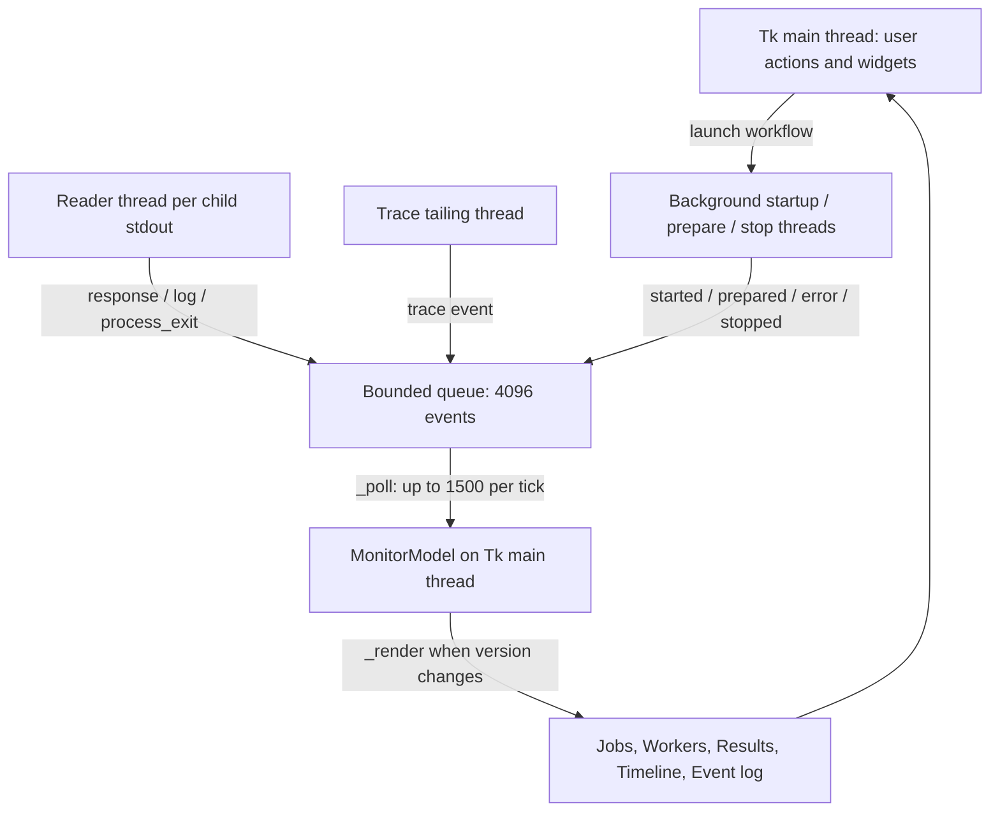

Background threads ไม่เรียก Tk
queue.put อาจรอเมื่อ queue เต็ม จึงเป็น backpressure ไม่ใช่ drop queue ที่โตไม่จำกัด
events มี controller_id; หน้าต่าง ignore events ของ controller เก่าหลังเริ่ม session ใหม่

Startup ตรวจว่ามี broker/worker/client/prepare executables
สร้าง session `gui-<uuid prefix>`, เปิด Broker แล้วรอ broker trace file ภายใน 5 วินาที
จากนั้นเปิด trace tailer, Workers และ Client โดยใช้ CREATE_NO_WINDOW
child stdout รวม stderr; reader ส่ง JSON ของ Client เป็น response events และข้อความอื่นเป็น log events ผ่าน queue
Client stdin ใช้ write_lock ป้องกันคำสั่งจากหลาย workflows ปนกัน

Prepare & submit เปิด Prepare process แยก รอ exit=0 แล้วจึงเขียนคำสั่งให้ Client
มี Preparing flag ป้องกันกด Prepare workflow ซ้อนจากปุ่มเดียวกัน
controller ตรวจ path/analysis/chunk ก่อนเริ่มและไม่ submit ต่อเมื่อกำลัง stop

### 16.3 Model updates และการแสดงผล

STATUS monitor เป็น authoritative snapshot:
ลบ Job/result ที่ Broker evict ไปแล้ว, update jobs/workers/ready queue/policy
ACCEPTED/PROGRESS/CANCEL_ACK/CANCELLED update counters โดยไม่ต้องรอ snapshot
COMPLETED จึงเก็บ successful summary; Failed/Cancelled ไม่สร้างผลสำเร็จ
model จำกัด 256 jobs และ evict terminal record ก่อน active record

GUI ส่ง Status ทุกประมาณ 2 วินาทีขณะ running
_poll ครั้งแรกหลัง 80 ms แล้ววนประมาณทุก 100 ms; ไม่ใช่ real-time sampling guarantee
widgets repaint เมื่อ model version เปลี่ยน; Results refresh ตาม selected Job และ summary ที่เปลี่ยน
Card “ADMITTED JOBS” คือ jobs ที่ยังเก็บใน model ไม่ใช่ lifetime total หลัง history eviction
ตัวเลข records เป็น merged partial/final ที่ model รู้ ไม่ใช่จำนวน records ที่ disk scan ไปทั้งหมด

| สิ่งที่เก็บ/แสดง | เพดาน |
|---|---:|
| Event queue ระหว่าง threads | 4,096 |
| Model events | 2,000 |
| Event table ที่วาด | 300 ล่าสุด |
| ChunkSpan history | 2,048 |
| Timeline ที่วาด | 160 chunks ล่าสุดที่มี assignment timestamp |
| Ready queue labels | 24 Jobs แรก พร้อมจำนวนที่เหลือ |

TraceTailer อ่านครั้งละไม่เกิน 256 KiB ต่อไฟล์, poll ราว 120 ms
รอ LF ก่อน parse JSON record; เก็บ partial final line ไว้ต่อรอบหน้า
ถ้า file size ลดต่ำกว่า offset จะ reset offset/pending; malformed JSON line ถูก log แล้วอ่านบรรทัดถัดไปต่อ
OSError ชั่วคราวจะลองอ่านใหม่รอบถัดไป

### 16.4 Timeline มีความหมายอะไร

- กรอบ assignment: Broker task_assigned → Broker result_received หรือ worker_disconnected
- แถบ compute: Worker compute_started → compute_finished/compute_failed
- กรอบแดง: Worker หลุด; ไม่สร้าง compute_finished ขึ้นเอง
- กรอบที่ยังเปิด: วาดถึง latest observed trace event ไม่ใช่เดาว่า Worker finish แล้ว
- ไม่มี QPC: ไม่สร้าง span จากเวลาที่ GUI ได้รับ event
- Trace files อาจถูก tail คนละลำดับ จึงจับคู่ด้วย IDs ไม่ใช่ลำดับบรรทัดที่ GUI เห็น
- Duplicate event ไม่เขียนทับ boundary แรก; origin ใช้ QPC ที่สังเกตได้

Timeline เป็นภาพเหตุการณ์จริง แต่ result_received ก่อน validation ยังไม่แปลว่า merge สำเร็จ
ดู chunk_merged และ Job state ประกอบเมื่อวิเคราะห์ correctness

<a id="s17"></a>
## 17. Trace และความหมายของเวลา

### 17.1 ที่เก็บและ schema

ค่า default: `build/traces/<session>/`
C++ components เขียน broker.jsonl, client.jsonl, worker.jsonl, worker2.jsonl ฯลฯ
แต่ละ Trace.log เขียน JSON หนึ่งบรรทัดและ flush; ล้มเหลวจะ throw ไม่เงียบ

| Field | ความหมาย |
|---|---|
| qpc_ticks, qpc_frequency | Monotonic timing counter และ ticks/second; ใช้หาผลต่างเวลา |
| pid, component | OS process ID และ logical component |
| wall_utc | UTC timestamp สำหรับอ่านด้วยตา; ไม่ใช้แทน QPC เพื่อคำนวณ latency |
| event, detail | ชื่อเหตุการณ์ และ reason/message kind/policy ตามเหตุการณ์ |
| request_id, job_id, chunk_id, worker_id | Correlation IDs; 0 เมื่อ event นั้นไม่มี identity ระดับนั้น |
| begin, end | TASK byte range เมื่อมีข้อมูล; ค่าเริ่มต้น 0 ไม่ใช่ช่วงของทุก event |
| job_state | State ที่ component รู้จริง; TASK/RESULT event ปกติ null |
| total_chunks, completed_chunks, in_flight, pending_chunks | Counters เมื่อ Message นั้นมีข้อมูล; event ทั่วไปอาจเป็น 0 |
| duration_us | Worker computation duration เมื่อเกี่ยวข้อง |

ไม่ควรตีความ Message default Queued ว่าเป็นสถานะ Job จริงใน Worker
Trace จึงใช้ null สำหรับ events ที่ไม่มี Broker state
State snapshot และ chunk_merged เป็นข้อมูลระดับ ownership ที่ต่างจาก Worker task/result

### 17.2 Event catalog

| Component/กลุ่ม | Events และความหมาย |
|---|---|
| Client | client_connected/client_stopped: lifecycle; command_started/command_sent: local send boundary; response_received: ได้ reply (รวม ACCEPTED) |
| Broker admission | broker_started, client_message_received, job_accepted, request_rejected; job_waiting_scheduling_turn หรือ job_waiting_free_worker บอกเหตุการณ์ตอนรับงาน |
| Broker execution | worker_ready, task_assigned, result_received, chunk_merged, result_discarded |
| Broker Job | job_cancelling, job_cancelled, job_completed, job_failed |
| Broker monitoring/delivery | client_message_received, response_queued, status_replied, client_delivery_failed |
| Broker stop/failure | worker_disconnected, client_protocol_failure, client_disconnected, stop_requested, shutdown_requested, worker_stopped, broker_stopped |
| Worker | worker_ready, task_received, test_delay_started, compute_started, compute_finished, compute_failed, result_queued, shutdown_received, worker_stopped |

command_started อยู่ก่อน channel.send หลัง validate/normalize command
compute_started อยู่หลัง artificial test delay; compute duration ไม่รวม delay
response_queued คือ Broker enqueue ไม่ใช่ Client รับแล้ว
chunk_merged ยืนยันว่าผลผ่าน validation และเข้า aggregate แล้ว

### 17.3 ข้อควรระวังในการอ่านเวลา

ใช้ `seconds = ticks/frequency`; สำหรับ elapsed ใช้ผลต่าง ticks หาร frequency
เทียบ QPC ของ processes ในเครื่องเดียวกันและตรวจ frequency สอดคล้องกัน
เวลาที่ GUI poll ไฟล์ไม่ใช่เวลาที่ computation เกิด
Trace เป็น synchronous file writes มี overhead และอาจ block event loop ถ้า disk ช้า
Async design ช่วยไม่รอ compute ของ Worker แต่ไม่ได้รับประกันว่า OS/disk/trace operation ทุกตัว nonblocking


<a id="s18"></a>
## 18. Setup, build, run และ options

### 18.1 Prerequisites และ build

Windows, GCC ที่รองรับ C++17 (`g++` และ `gcc` ใน PATH), Python 3.10+ พร้อม Tkinter
Python ใช้ standard library ทั้งหมด ไม่มี pip requirements
RISC-V ใช้ cross toolchain เพิ่มตามบท 23; MOS ใช้ tools ที่เก็บในโปรเจกต์

ทุกคำสั่งในตัวอย่างรันจาก project root:

```powershell
./scripts/build.ps1
python Client/gui.py
```

build.ps1 compile analyzer/chunks/message/ipc เป็น common objects
แล้ว link client, broker, worker, reference, prepare และ common_tests เป็น executables ใน build/
Flags: C++17, -O2, -g, -Wall/-Wextra/-Wpedantic/-Werror, _WIN32_WINNT=0x0601,
-ICommon, -pthread, static libgcc/libstdc++; link shell32 เพื่อใช้ Unicode command-line APIs
Compile/link failure ทำให้ script throw และหยุด ไม่ไปใช้ executable เก่าว่าเป็น build สำเร็จ

VS Code ให้ Open Folder ของ project root
IntelliSense config ใช้ `C:/TDM-GCC-64/bin/g++.exe`, C++17 และ Common include path
compiler เป็นผู้ระบุ Windows/standard headers ให้อัตโนมัติ
ถ้าติดตั้งคนละ path ให้แก้ compilerPath; หาก diagnostic ค้างใช้
`C/C++: Reset IntelliSense Database` แล้ว `Developer: Reload Window`

### 18.2 GUI walkthrough

1. ตั้ง Workers, FIFO/Round-robin, Chunk KiB และ Capacity
2. Start cluster แล้วรอ CONNECTED
3. เลือก CSV และ route/time แล้ว Prepare & submit
4. ดู Jobs/Workers/ready queue; ส่ง Job เพิ่มหรือ Cancel selected ระหว่างทำงานได้
5. เลือก Job แล้วดู Results เมื่อ Completed; ดู Timeline/Event log เพื่อดู execution
6. Stop หรือปิดหน้าต่างเพื่อเริ่ม graceful stop

GUI defaults: Workers=3, policy=Round-robin, chunk=64 KiB, capacity=32
GUI รับ Workers 1–8, chunk 1–65,536 KiB, capacity 1–128 และ lock config ขณะ cluster ทำงาน
Broker CLI default เป็น FIFO และ Prepare CLI default chunk=1 MiB จึงอาจต่างจาก GUI ถ้าไม่ระบุค่า

### 18.3 Console walkthrough

Terminal แรก:

```powershell
python scripts/generate.py --file build/demo.csv --records 100000 --seed 42
./build/prepare.exe --file build/demo.csv --chunk-bytes 65536
./build/broker.exe --session demo --workers 3 --policy rr --capacity 32
```

เปิด Worker commands ต่อไปนี้ใน terminals แยกกัน แล้วเปิด Client อีก terminal:

```powershell
./build/worker.exe --session demo --id 1
./build/worker.exe --session demo --id 2
./build/worker.exe --session demo --id 3
./build/client.exe --session demo
```

ใน Client:

```text
submit route "build/demo.csv"
submit time "build/demo.csv"
status
status 1
cancel 1
shutdown
quit
```

ใช้ Job ID ที่ได้รับจริง; ตัวอย่างคำสั่งนี้แสดง syntax ไม่บังคับให้ cancel Job 1 ทุก run
shutdown ขณะมีงานค้างจะ reject ให้ cancel/รอแล้วค่อยสั่งใหม่
ไม่ต้องเปิด GUI เพื่อใช้ console และไม่ควรเปิด GUI ไปควบคุม manual session เดียวกัน

Serial reference และ Prepare:

```powershell
./build/reference.exe --file data/small.csv --analysis route
./build/reference.exe --file data/small.csv --analysis time --timing-file build/serial.json
./build/prepare.exe --file build/demo.csv --chunk-bytes 65536
```

Prepare stdout fields: index, file_size, chunk_bytes, total_chunks, prepare_us
Reference stdout คือ summary; timing-file มี start_ticks, finish_ticks, qpc_frequency,
duration_us, bytes, valid_records, malformed_records
duration ของ Reference เริ่มก่อน analyze และจบก่อน JSON/timing serialization ไม่รวม process startup

### 18.4 C++ CLI option catalog

Options ใช้ `--name value` เป็นคู่; unknown/duplicate/missing value หรือ signed numeric strings ถูก reject
ใช้ original UTF-16 Windows command line แล้วแปลงเป็น UTF-8 เพื่อรองรับ path ภาษาไทย

| Executable | Options/defaults |
|---|---|
| Broker | --session demo, --trace build/traces/session, --workers 3 (1–8), --policy fifo (fifo/rr), --capacity 32 (1–128), --io-mode async (async/sequential-wait) |
| Worker | --session demo, --trace ตาม session, --id 1 (1–8), --delay-ms 0 (0–10,000) |
| Client | --session demo, --trace ตาม session |
| Prepare | --file FILE, --chunk-bytes 1,048,576 (1..8 GiB) |
| Reference | --file FILE, --analysis route (route/time), --timing-file PATH เป็น optional |

delay-ms เป็นการทดลอง responsiveness ไม่ใช่ parameter การวิเคราะห์ CSV
Application ไม่ใช้ threads เพิ่มต่อ Worker เพื่อทำหลาย TASK พร้อมกัน

<a id="s19"></a>
## 19. Generator และการวัดผล Windows

### 19.1 Generator

generate.py สร้าง physical data records ตามจำนวนที่ระบุ ไม่รวม header
ใช้ Python Random(seed) เพื่อให้ seed/config เดียวกันสร้าง bytes เดิมใน environment เดียวกัน
base timestamp คือ 2026-10-11T00:00:00Z และ routes ชื่อ /route-0000 เป็นต้นไป
ไฟล์ metadata ชื่อ `<CSV>.meta.json` เก็บ config, realized valid/malformed/error counts และ byte size

| Option | Default/ความหมาย |
|---|---|
| --file | Required output CSV path |
| --records | 10,000; รับ 0..100,000,000 |
| --error-ratio | 0.2; ความน่าจะเป็นเลือก error status |
| --routes | 16; รับ 1..4,096 |
| --seconds | 3,600; time range ต้องเป็นบวก |
| --seed | 42 |
| --hotspot | 0.6; เมื่อเป็น error มีโอกาสนี้ที่จะเลือก route 0 |
| --burst-start / --burst-width | 900/120 seconds; burst ต้องอยู่ภายใน time range |
| --burst-fraction | 0.5; เมื่อเป็น error มีโอกาสนี้ที่จะอยู่ใน burst |
| --malformed-ratio | 0.0; สร้างบรรทัด malformed-record แทน valid record |

ratios ทุกตัวอยู่ [0,1]; realized ratios ไม่ต้องตรงค่าคาดหมายเป๊ะเพราะเป็น random sampling
error statuses เลือกจาก 400/401/403/404/429/500/502/503
nonerror เลือกจาก 200/201/204/301
ทุก record ที่ไม่ถูกแทนด้วย malformed มี timestamp/route/status ตรง dialect ของ analyzer

### 19.2 ความน่าเชื่อถือของ expected result

Reference ใช้ C++ parser เดียวกับ Workers จึงเป็น serial comparison แต่ไม่ใช่ implementation อิสระ
Independent Python oracle ใน tests/support.py ใช้เฉพาะ dialect ที่ generator สร้างและ marker malformed-record
ไม่ได้แทน full CSV validator สำหรับ arbitrary invalid input
malformed edge cases ใช้ hand-counted fixtures และ explicit negative cases ใน C++/process tests เพิ่มเติม

### 19.3 Experiment matrix

```powershell
python scripts/experiments.py
# ตรวจทุก configuration แต่ใช้ repetition เดียว:
python scripts/experiments.py --repeats 1
```

| Parameter | Default |
|---|---|
| --records / --small-records | A=500,000 / B=1,000; ต้อง 0<B<A |
| --repeats | 3; ต้องเป็นบวก |
| --seed | 20261017 |
| --output | build/experiments.json |

ต่อหนึ่ง repetition:

| Experiment | Configurations | Clusters |
|---|---|---:|
| Real Route | FIFO/RR × Workers 1/2/3 × chunks 64/256/1024 KiB; แต่ละ config รัน A alone, B alone, mixed | 54 |
| Time | A alone, FIFO × Workers 1/2/3 × chunks 64/256/1024 KiB | 9 |
| Controlled delay | FIFO/RR × async/sequential-wait, Workers=2, chunks=32 KiB; แต่ละ config รัน A alone/B alone/mixed | 12 |
| รวม | 75 ต่อ repetition; default 3 repetitions | 225 |

A/B ของ real workload ใช้ 64 routes และ malformed ratio=0.01
controlled ใช้ A=10,000/B=500 records, delay W1=120 ms/W2=12 ms
ลำดับ configurations ถูก shuffle ตาม seed
แต่ภายใน config ต้องวัด alone ก่อน mixed เพื่อได้ baseline slowdown
mixed รอ A เริ่ม compute/test-delay แล้วจึง submit B และตรวจว่า B submit ก่อน A จบจริง

ก่อนรันเก็บ input SHA-256, metadata, machine/compiler info และ serial timings
ทุก run ใช้ actual processes, ตรวจ summary ตรง expected ทุก key และตรวจ assignment/result ครบ
เมื่อจบต้องไม่มี ready/in-flight ค้าง แล้ว shutdown cluster
Output checkpoint เริ่ม passed=false เพื่อไม่ทิ้ง passed=true เก่าหาก run นี้ล้มเหลว
เมื่อครบจึงตั้ง passed=true และเขียน aggregates

### 19.4 Metric definitions

ให้ C0=Client command_started, C1=Client response_received ACCEPTED,
B0=Broker job_accepted, B1=first task_assigned, B2=Broker job_completed,
C2=Client response_received COMPLETED; ทุกช่วงแปลงด้วย QPC frequency

| Metric | สูตร/ขอบเขต |
|---|---|
| Admission ms | (C1−C0)×1000; รวมเวลา Broker รับงานและการส่ง ACCEPTED กลับ |
| Queue ms | (B1−B0)×1000 |
| Turnaround ms | (B2−B0)×1000 |
| Client response ms | (C2−C0)×1000 |
| Job throughput | valid_records / turnaround_seconds |
| System throughput | ผลรวม valid ของ Jobs ที่วัด / ช่วง first acceptance ถึง last completion |
| Worker compute sum | ผลรวม parser microseconds ของ chunks ที่ merge; ไม่ใช่ wall time เพราะทำขนานกัน |
| First compute ms | Worker compute_started แรก − B0 |
| Assignment busy fraction | ผลรวม assignment→result ที่ตัดตาม observation window / window |
| CPU fraction | ผลต่าง kernel+user process CPU seconds / ผลต่าง sample wall seconds |
| Handle delta | executive handles หลัง−ก่อน measurement จาก GetProcessHandleCount |
| Slowdown | mixed turnaround / alone turnaround ของ Job/config/repetition เดียวกัน |
| Serial parse / turnaround | serial duration_us / multiprocess turnaround_us; boundary ต่างกัน ต้องระบุเมื่อรายงาน |
| Jain fairness | กำหนด x_i=1/slowdown_i; J=(sum x_i)^2 / (n*sum x_i^2) |

Jain ใกล้ 1 หมายถึง slowdowns สมดุลกัน ไม่ได้แปลว่าทุก Job เร็ว
Time-only และ alone run ตั้ง slowdown=1 เป็น baseline ไม่ใช่การวัด mixed fairness
CPU telemetry มี sampling window ก่อน/หลัง Status probes จึงไม่ตรง assignment window เป๊ะ
Artificial delay ไม่รวม worker_compute_us แต่รวม assignment/turnaround/CPU observation window ตามจริง

Channel sent counters เพิ่มเมื่อ enqueue; received bytes เพิ่มเมื่อ collect reads และ received messages เมื่อ decode
IPC delta จาก Status ก่อน/หลังรวม response ของ probe แรกกับ request ของ probe หลัง
มี message delta แบบลบสอง probe messages แต่ไม่ได้อ้างว่าลบ probe bytes ได้ครบ

distribution เก็บ n/min/median/max/p95 แบบ nearest rank
summarize แยก experiment/policy/io-mode/workers/chunk/scenario ไม่เอาคนละ config มาปน
sha256/reference/one/measures/execute/fairness/summarize เป็น helper ตามขั้นตอนนี้;
one บังคับให้แต่ละ timing boundary ตรง event เดียว ไม่หยิบ event แรกที่อาจเป็น duplicate มาใช้เงียบ ๆ

ระบบไม่ได้ควบคุม OS background load, disk cache หรือ CPU frequency
ไม่สรุป guaranteed speedup, hard real-time หรือ energy saving จากตัวเลขชุดนี้
output ของ experiments เป็นผลรันปัจจุบันใต้ build/ ไม่ใช่รายงานประวัติที่ต้องเก็บใน source


<a id="s20"></a>
## 20. MOS: circular buffer และ semaphore

### 20.1 Application และ memory

MOS workload ใช้หนึ่ง Producer (`writer`) กับ Consumers (`reader`) 1–8 ตัว
Producer สร้างค่าลำดับ 1..items; Consumers รวมกันต้องอ่านครบในลำดับ FIFO โดยไม่มีข้อมูลหาย/ซ้ำ
แต่ละ Consumer อ่าน `quota = items/consumers` จึงต้องหารลงตัว

| Shared variable | ความหมาย/initial |
|---|---|
| buffer | memory array ขนาด capacity=K |
| head, tail | index ที่อ่าน/เขียนถัดไป; เริ่ม 0 และ wrap modulo K |
| occupancy | จำนวน items ที่อยู่ใน buffer; เริ่ม 0 |
| produced, consumed | จำนวน write/read ที่ commit แล้ว |
| lastWritten, lastTaken | ค่าล่าสุดเพื่อให้ observer ตรวจ actual put/get |
| empty | Semaphore initial K; จองช่องว่างก่อนเขียน |
| full | Semaphore initial 0; จอง item ก่อนอ่าน |
| mutex | Semaphore initial 1; mutual exclusion ของ critical section |

Process ของ MOS ใช้ memory ใน S2 simulator ร่วมกัน ซึ่งต่างจาก Windows processes ที่มี memory แยก
สื่อสารข้อมูลผ่าน buffer ไม่ได้ผ่าน Named Pipes

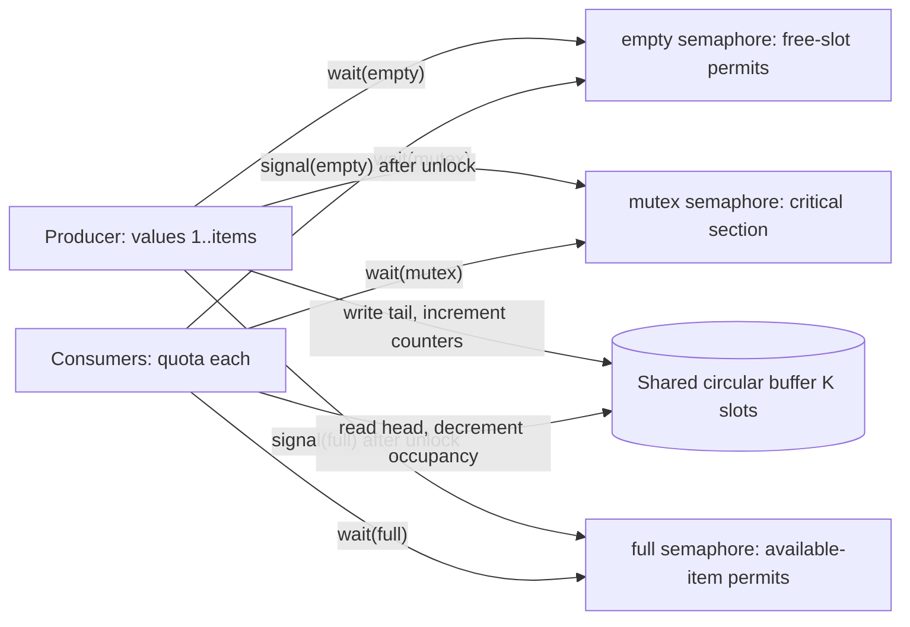

### 20.2 ลำดับ Producer/Consumer

| Producer หนึ่งรอบ | Consumer หนึ่งรอบ |
|---|---|
| wait(empty) | wait(full) |
| wait(mutex) | wait(mutex) |
| buffer[tail]=next value, update lastWritten | item=buffer[head], update lastTaken |
| tail=(tail+1) mod K | head=(head+1) mod K |
| occupancy++, produced++ | occupancy--, consumed++ |
| signal(mutex) | signal(mutex) |
| signal(full) | signal(empty) |

wait resource ก่อน wait mutex เพื่อไม่ถือ mutex ค้างขณะรอ buffer ไม่เต็ม/ไม่ว่าง
เสร็จ loop แล้วแต่ละ process เรียก terminate

main ปิด timer interrupt, initialize Q/freelist/counters/buffer,
สร้าง Consumers ก่อน Producer, ตั้ง qq เพื่อให้ first dispatch ไป Consumer ที่ต้องรอ full,
สร้าง semaphores, ตั้ง timer แล้ว boot
การเริ่มด้วย empty buffer ทำให้ทดสอบ blocking/wakeup ได้จริง

**Semaphore value ไม่เท่ากับ occupancy ทุก instruction**
permits อาจถูกจองแล้วแต่ยังไม่ commit write/read และค่าติดลบแทนจำนวนที่รอ
จึงไม่อ้างว่า empty+full=K หรือ full=occupancy ต้องเป็นจริงทุก snapshot
ตรวจ occupancy bounds ตลอด และตรวจ final permits คืนเป็น empty=K/full=0/mutex=1 เมื่อทุก process จบ

### 20.3 MOS kernel routines

| Routine/โครงสร้าง | หน้าที่ |
|---|---|
| newp/newStack/newFrame | จัด memory ของ PCB 16 words, stack 64 words, frame 64 words |
| createp | สร้าง initial context, runnable flag=1 แล้ว enqueue |
| Q | Circular process list ที่เก็บ PCB pointers |
| qq | Pointer ของตำแหน่งปัจจุบันใน Q เพื่อเดินเลือก candidate |
| enqueue | เพิ่ม PCB pointer ใน Q และ nump |
| dequeue | ลด nump และตั้ง current PCB runnable flag=0; ไม่ free PCB |
| nextQ/nextp | เดิน circular list เลือก PCB ที่ runnable; build ปกติใช้ safe nextp |
| terminate | Disable timer, dequeue current, enable timer แล้ว software interrupt #0 |
| boot | สร้าง zeroth context นอก Q แล้ว interrupt เพื่อเริ่ม process จริง |
| new/free | Allocate/recycle list cells ผ่าน freelist |
| appendL/deleteL | เพิ่มท้าย/ลบหัว linked list; ใช้กับ semaphore FIFO wait queue |
| newsem | สร้าง counter และ waiting-list header |
| wait | Disable timer, decrement; ถ้าติดลบ enqueue current แล้ว blockp; enable เมื่อกลับทำต่อ |
| blockp | Mark not runnable และ software interrupt เพื่อเลือก process อื่น |
| signal | Disable timer, increment; ถ้า ≤0 เอาหัว wait queue ไป wakeup; enable |
| wakeup | nump++ และ runnable flag=1; ยังไม่บังคับว่าต้องได้ CPU ทันที |
| int0 | Save interrupted context, select runnable PCB, restore แล้วกลับ execution |

คำว่า ready ใน MOS หมายถึง runnable PCB
ไม่เหมือน Ready Worker ที่หมายถึงพร้อมรับ chunk ใหม่ใน Windows

<a id="s21"></a>
## 21. MOS: interrupt, scheduler และ S2 simulator

### 21.1 PCB และ registers

PCB fields ที่ใช้จริง:

| Offset จาก PCB address | ข้อมูล |
|---:|---|
| 0 | Saved PC |
| 1 | Saved SP หลัง pushm |
| 2 | Saved FP |
| 3 | Saved rads |
| 4 | Saved retval |
| 5 | Runnable flag |
| 6..15 | Allocation ที่เหลือ; ไม่ใช่เพิ่ม fields ที่ validator พึ่งพา |

S2 มี R[0..31], memory M[0..19999], Pc, Ir และ RetAds
r27=rads, r28=retval, r29=SP, r30=FP
int0 ใช้ scratch r20/r21 และเก็บ process registers r0..r15 ลง process stack
stack โตขึ้น: push เพิ่ม SP แล้ว store; pop อ่านแล้วลด SP
หลัง popm SP จึงเท่ากับ saved SP−16

### 21.2 Interrupt → context switch

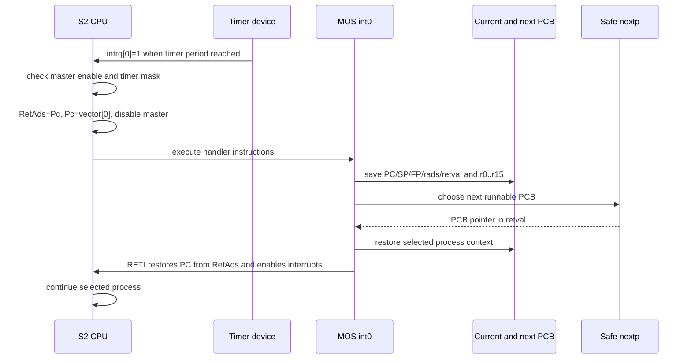

Software interrupt #0 จาก blockp/terminate ใช้ handler ทางเดียวกัน
ถ้า nump=0 handler trap stop simulator
Observer เห็น timer/software interrupt, PCB changes และ dispatch จาก execution จริง

### 21.3 ทำไมต้องแทน nextp

Course nextp เดิมเป็นฟังก์ชันปกติที่ใช้ call/frame และเรียก nextQ
interrupt อาจเกิดกลาง function prologue/epilogue ของ application
FP ณ จุดนั้นจึงไม่เหมาะให้ scheduler ใช้เป็น frame ของตนเอง
safe nextp ใช้ `#noframe`, เดิน qq ด้วย assembly r20/r21 และคืน PCB ใน retval
ไม่ใช้ process registers r0..r15 หรือ interrupted frame

run.py แทนเฉพาะ nextp ใน generated source และเก็บ int0 ต้นฉบับ
tests ตรวจว่า body ของ int0 ไม่เปลี่ยน
ตัวเลือก original-scheduler ใช้สำหรับ reproduce regression; test คาดว่า validation ต้อง fail
จึงไม่ใช่ alternate normal scheduler ที่รองรับใช้งานสำเร็จเหมือนกัน

### 21.4 Course C simulator แต่ละส่วน

| Source/ฟังก์ชัน | พฤติกรรม |
|---|---|
| s21.h | Opcodes/immediates/extended ops, MAXMEM=20000, INTVEC=1000, STRSEG=9000, HEAP=10000 |
| load.c: IRop/IRr1/IRads/IRr2/IRr3/IRxop/IRdisp | Decode fields ของ instruction word และ sign-extend displacement |
| load.c: loadprogram, geta/geti, loadsym | อ่าน course object format L/D/X, addresses/constants และ optional symbols |
| load.c: disassem, pr* helpers, show | แปลง instruction เป็นข้อความและแสดง registers; ใช้ในการ debug |
| load.c: error | Course error handler; ไม่ใช้ exit code เพียงอย่างเดียวตัดสิน correctness |
| s21.c: signx2 | Sign extension ของ immediate 22-bit |
| s21.c: myalloc | Bump allocator ใน memory ของ simulator; เกิน MAXMEM จะ error |
| s21.c: trap | Stop/print/input, set timers, enable/disable masks, device reads และ malloc |
| s21.c: run | Fetch/decode/execute instruction หนึ่งตัว; load/store, arithmetic, branch, stack, interrupt ops |
| s21.c: interrupt | Save return PC ใน RetAds, กระโดด vector, disable master interrupt, clear request |
| s21.c: checkinterrupt | เลือก pending interrupt ตาม mask/priority 0..3 เมื่อ master enable |
| s21.c: runoneclock | clock++, simdevices, execute เมื่อ CPU active แล้ว check interrupts |
| s21.c: original main | Interactive course entry point; build adapter rename เป็น course_main |
| io.c: gensin/gendig/readsinport/readdigport/show* | สร้าง/read/display waveform devices; ไม่ใช่ input ของ buffer experiment |
| io.c: init_io, myrandom | Initialize devices/RNG; build copy แทน nonstandard RNG ด้วย ISO C |
| io.c: simdevices | เพิ่ม timer counters และตั้ง interrupt requests เมื่อครบ period |

S2 เป็น ISA ของ course simulator; instruction names ของมันไม่ใช่ RISC-V
เราใช้ trusted compiler-generated objects ของวิชา
loader/interactive routines เดิมไม่ได้ออกแบบเป็น sandbox สำหรับ untrusted programs

<a id="s22"></a>
## 22. MOS: build, observer และ trace validation

### 22.1 Build pipeline

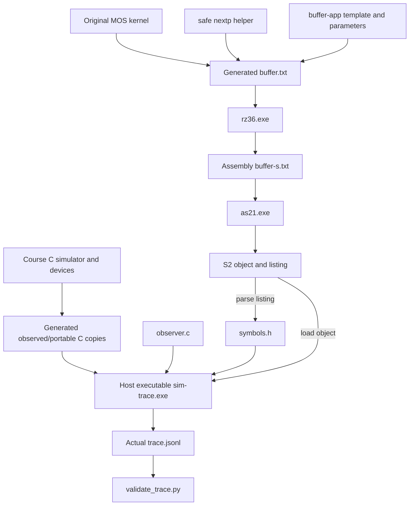

run.py ทำตามลำดับ:

1. ตรวจ parameter ranges/tools และเลือก output directory
2. ตัด application เดิมออกจาก original course file, แทน safe nextp ตาม mode แล้วเติม buffer app
3. แทน @CAPACITY@/@ITEMS@/@CONSUMERS@/@TIMER@
4. เรียก Rz36 แล้วตรวจทั้ง return code และคำว่า error ใน compiler output
5. ส่ง assembly ให้ as21 ต้องได้ object/listing
6. symbols() แปลง global/label addresses และ reject code ที่ overlap interrupt vector ที่ address 1000
7. สร้าง symbols.h (global/label addresses เป็น #define) สำหรับ observer
8. สร้าง C copies ที่ rename main, แทน interrupt printf ด้วย observer hook และเพิ่ม after-instruction hook
9. แทน dependency random.h เฉพาะ generated io copy; course source ไม่ถูกแก้
10. GCC build ด้วย C99, -O2, -fwrapv และ -lm
11. รัน actual simulator มี max-clocks bound แล้ว validate trace
12. เขียน manifest config และ validation passed/error; subprocess steps timeout 60 วินาที

command() capture stdout/stderr ลง step logs และยก error เมื่อ command fail
original course runtime บาง error paths exit(0) จึงต้องตรวจ actual init/stop trace และ invariants ด้วย

### 22.2 Observer อ่านอะไร

Observer ไม่ implement semaphore หรือ scheduler ใหม่
before() ตรวจ PC ก่อน instruction ว่ากำลังเข้า boot/wait/signal/blockp/wakeup/terminate
mos_after_instruction() เปรียบเทียบ memory/queue/counters หลัง instruction จริง
mos_interrupt() hook อยู่ก่อน simulator แก้ RetAds/Pc เพื่อบันทึก interrupt boundary

| Helper/event | บทบาท |
|---|---|
| memory | Bounds-check address ก่อนอ่าน M |
| queue/contains | อ่าน linked wait queue จริงและเทียบสมาชิกก่อน/หลัง |
| list/emit | Serialize arrays และ snapshot เป็น JSONL |
| begin | จับ PCB addresses/semaphore pointers ตอนเข้า boot แล้ว emit init |
| wait/signal/block/wakeup | เห็น function entry จริง ไม่ใช่เดาจาก occupancy |
| queue_enter/queue_leave | เห็น membership เปลี่ยนใน actual semaphore queues |
| semaphore_value | Counter เปลี่ยน |
| selected | currentp เปลี่ยน; ยังต่างจาก dispatch หลัง restore เสร็จ |
| put/get | produced/consumed เปลี่ยน; value มาจาก lastWritten/lastTaken |
| terminate/terminated | เริ่ม terminate และ runnable flag เปลี่ยนจนถือว่าจบ |
| timer_interrupt/software_interrupt | simulator เข้า interrupt จาก timer หรือ INT instruction |
| dispatch | execute RETI แล้วกลับ selected context |
| stop | actual CPU runflag กลายเป็น 0 |

trace snapshot มี seq, clock, event, subject, semaphore, value,
current, pc, instruction_pc, sp, fp, rads, retval, retads,
intflag, timer_mask, timer_pending, nump,
head, tail, occupancy, produced, consumed,
semaphores, pcbs, registers[32], buffer[K] และ ready PCB addresses
pcbs แต่ละตัวมี address, role, terminated, context[6] และ saved_registers[16]
semaphores แต่ละตัวมี address, value และ waiting PCB list
หน่วย clock เป็น S2 simulation clocks ไม่ใช่ milliseconds/QPC ของ Windows

### 22.3 Validator ตรวจอะไร

- Trace ต้องเริ่ม init และจบ actual stop; seq เพิ่มทีละ 1 และ clock ไม่ถอยหลัง
- Initial permits ต้อง K/0/1 และ occupancy/head/tail ไม่เกินขอบเขตตลอด
- Wait queue ห้ามสมาชิกซ้ำ; queue entry ต้องสัมพันธ์กับ negative semaphore
- queue_leave ต้อง FIFO; wakeup ต้องมี queue removal ที่ทำให้ eligible ก่อน
- block ต้องอยู่ใน waiting queue หนึ่งแห่ง; semaphore value เปลี่ยนทีละหนึ่ง permit
- put/get ต้องถือ mutex และตรง actual shared buffer memory
- Values ต้อง produced/consumed เป็น 1..items ตามลำดับ ไม่มีหาย/ซ้ำ/reorder
- Counters, occupancy และ circular indices ต้องตรง observed operations
- dispatch ต้องเลือก runnable/nonterminated/not-waiting PCB
- PC/SP/FP/rads/retval และ r0..r15 ต้องตรง context/stack ที่ restore
- nump กับ runnable flags และ negative semaphore กับ queue length ต้องตรงที่ dispatch
- Stop ต้องทุก process terminated, ไม่มี waiting/wakeup ค้าง, quotas ครบ, occupancy=0
- Final permits กลับ K/0/1 และ trace ต้อง exercise block/wakeup/dispatch จริง

validate() อ่าน actual events แล้วตรวจ invariants ไม่ได้สร้าง execution จำลองเพื่อใช้แทน trace
Return มี passed, implementation, simulation_clocks, events, produced, consumed,
max_occupancy, event_counts, consumed_per_pcb

### 22.4 คำสั่งและ options

```powershell
python MOS/run.py --capacity 3 --items 24 --consumers 2 --timer 400
python MOS/validate_trace.py build/mos/k3-c2-t400/trace.jsonl
# negative regression แบบตั้งใจใช้ scheduler เดิม:
python MOS/run.py --original-scheduler --max-clocks 100000
```

| Option | Default / range |
|---|---|
| --capacity | 4 / 1–64 |
| --items | 24 / 1–10,000 และหาร consumers ลงตัว |
| --consumers | 1 / 1–8 |
| --timer | 400 / 64–1,000,000 simulation clocks |
| --max-clocks | 2,000,000 / 1,000–100,000,000 |
| --tools | MOS/tools |
| --gcc | gcc จาก PATH |
| --output | build/mos/kK-cC-tT |
| --original-scheduler | Flag; ปกติไม่เปิด; ใช้ reproduce expected failure |

Standalone validator ใช้ manifest.json ข้าง trace โดย default หรือระบุ --manifest PATH
Run config เดิมซ้ำ default output เดิมจะถูกเขียนใหม่ ควรใช้ --output หากต้องการแยก run ขณะทดลอง
Generated directory มี buffer.txt, assembly/object/listing, symbols,
C adapters, simulator executable, logs, trace.jsonl, manifest.json, validation.json

### 22.5 Original source provenance

Original kernel: `C:/2110585_Hardware_Design/mos-writer-reader/mos-rz2.txt`
SHA-256: `ff0feced5adb869d39c57e6502d87301f47f51e9487a03b26ed1af6e121aa8d0`
C simulator มาจาก `C:/2110585_Hardware_Design/iot-rz/sim21/`
course tools มาจาก `mos-writer-reader/tools/`
เก็บ author headers ของ P. Chongstitvatana/Chulalongkorn University ตามต้นฉบับ
paths เหล่านี้อธิบายที่มา ไม่ใช่ runtime dependency; build ใช้ copies ที่อยู่ในโปรเจกต์


<a id="s23"></a>
## 23. RISC-V ISA example

ส่วนนี้เป็น freestanding counting function ขนาดเล็ก ไม่อ่าน CSV และไม่เชื่อมกับ Windows/MOS
Input คือ status array ของ unsigned int 32-bit และ length
Output คือ unsigned count ผ่าน error_count pointer
นับค่าในช่วง 400..599 แบบ inclusive โดยวน index 0..length−1
Input array กับ output word ต้องแยก memory กัน และ output pointer ต้องใช้ได้

| Source | พฤติกรรม |
|---|---|
| count_errors.c | count_http_errors(status,length,error_count): initialize count=0, ตรวจช่วง, เพิ่ม count แล้วเขียน output |
| test_count_errors.c | ตรวจ unsigned int เป็น 4 bytes, array [200,399,400,499,500,599,600,999] ให้ 4; length=0 ให้ 0 รวม NULL input เมื่อ length=0 |
| build.py: run | Execute compiler/binutils/native tests แบบ capture output พร้อม 60-second timeout |
| build.py: main | ตรวจ toolchain, compile assembly/object, ตรวจ ELF/instructions, build/run native assertions |

```powershell
python MOS/riscv/build.py
python MOS/riscv/build.py --toolchain C:/path/to/bin --host-cc gcc --output build/riscv
```

Default toolchain directory:
`%LOCALAPPDATA%/Arduino15/packages/esp32/tools/esp-rv32/2411/bin`
ต้องมี riscv32-esp-elf-gcc.exe, objdump.exe และ readelf.exe ตาม prefix
Compile flags: -march=rv32i, -mabi=ilp32, -ffreestanding, -fno-builtin, -O1

Output: count_errors.rv32i.s, .o, ELF/disassembly text และ native host test executable
ตรวจว่า ELF machine เป็น RISC-V/architecture rv32i2p1 และมี lw, sw กับ conditional branch class
native test ใช้ gcc -std=c99 -Wall -Wextra -Werror

**ขอบเขตหลักฐาน:** compile/disassembly ยืนยันว่าเกิด RV32I object และ instruction classes ที่ต้องการ
native test ยืนยัน C semantics บน host
ยังไม่ได้ execute RV32I object บน emulator หรือ hardware จึงไม่อ้างว่าได้ทดสอบ RISC-V runtime แล้ว

<a id="s24"></a>
## 24. Tests และหลักฐานที่แต่ละชุดตรวจ

### 24.1 วิธีรัน

```powershell
./scripts/test.ps1
```

ลำดับ: build → tests/processes.py (เรียก common_tests ด้วย) → GUI tests ที่เปิด process/native checks
→ measurement tests → MOS tests → RISC-V build/native checks
Script ตรวจ exit code ทุกคำสั่งและคืนค่า environment LGA_GUI_PROCESS_TESTS เดิมเมื่อจบ
Experiment matrix ไม่อยู่ใน test.ps1; รันแยกตามบท 19

รันแยกหลัง build:

```powershell
./build/common_tests.exe
python tests/processes.py
$env:LGA_GUI_PROCESS_TESTS = '1'
python -m unittest discover -s tests -p test_gui.py -v
Remove-Item Env:LGA_GUI_PROCESS_TESTS
python -m unittest discover -s tests -p test_experiments.py -v
python -m unittest discover -s MOS/tests -p test_mos.py -v
python MOS/riscv/build.py
```

ถ้าไม่เปิด LGA_GUI_PROCESS_TESTS=1 จะข้าม GUI real-process 2 tests และ native Tk 1 test
Model/tailer tests ยังรันได้โดยไม่เปิดหน้าต่าง
README ระบุ coverage จาก test definitions; การมี tests อยู่ไม่ได้แปลว่า run ปัจจุบันผ่าน
ให้อ่าน PASS/OK และ exit code จากคำสั่งที่เพิ่งรัน ไม่ใช้รายงานเก่าเป็นหลักฐาน

### 24.2 Common C++ contracts

common_tests.cpp ใช้ require/rejects helpers และ main ชุดเดียวตรวจ:

| กลุ่ม | Cases |
|---|---|
| CSV/accounting | Hand-counted Route/Time, BOM/CRLF/EOF, leap year, blank/invalid UTF-8, status boundaries, field count, route whitespace |
| File/header | Header-only success, empty/bad header failure |
| Framing | Feed ทีละ byte, หลาย frames ต่อ read, invalid magic/version/length, result round-trip และ invalid counts |
| Chunks | Targets 1/32/70/10000, coverage ไม่มี gap/overlap, reverse-order merge ตรง serial |
| Locking/identity | Concurrent writer/delete ถูกปฏิเสธ, wrong identity, split-record boundary, stale sidecar |
| Metadata bounds | Corrupt range, empty input, invalid target และ giant malformed line |
| Aggregation | Key limit และ overflow reject ก่อน validation mutation |
| Wire v2 extensions | TASK stamp/range, progress/cancel/status counters, ACCEPTED chunk count และ CANCEL target |

### 24.3 Real process acceptance

| Routine ใน processes.py | สิ่งที่ตรวจ |
|---|---|
| transport | Real pipes/three-process roundtrip, status ระหว่าง delay, request correlation, Route/Time, >4 KiB result, bad header/reuse, Unicode path, worker loss, wrong assignment, EOF |
| input_limits | 8,192/8,193 bytes × LF/CRLF/EOF, report error และ drain admitted work; context exit ต้องปิด children แม้ test throw |
| concurrency | Generator bytes ทำซ้ำได้, Workers 1/2/3 เทียบ serial/oracle, controlled out-of-order, exact FIFO/RR order, queued/active cancel |
| concurrency ต่อ | Capacity reuse, Worker loss isolation, Client loss, replay duplicate, same-size stale edit, Unicode prepared chunks, repeated shutdown, signed option rejection |
| correctness | BOM/leap/CRLF/invalid/giant line, no-errors, header-only หลาย target และ Route/Time เทียบ hand-count/serial |
| continuous(saturate=True) | ส่งต่อเนื่อง 4 waves ×32, บังคับให้เกิดทั้ง accept/reject ที่ capacity=6 และ settle ทุก wave |
| continuous(saturate=False) | 10 waves ×32 รวม 320 accepted; history คง 256, Job เก่าถูก evict, handles ไม่สะสมเกิน tolerance |
| cancellation_loss | Cancel ขณะมีสาม assignments แล้วฆ่า Worker; ต้อง Cancelled เมื่อ settle ครบ และ Workers ที่เหลือทำ Job ใหม่ได้ |
| progress_bound | 1,000 tiny chunks; ผลครบแต่ PROGRESS ไม่หนึ่ง message ต่อ chunk และอยู่ใน rate bound |
| resources | Entry point เรียก correctness/continuous/cancellation_loss/progress_bound |

snapshot helper ขอ monitor ตาม request counter; settled helper ตรวจ ready queue ว่าง,
jobs terminal/in-flight=0/pending=0 และไม่มี Busy Workers
result_payload สร้าง synthetic binary result สำหรับ protocol negative tests

### 24.4 GUI: 15 tests

| กลุ่ม | พฤติกรรมที่ตรวจ |
|---|---|
| Model 9 tests | Snapshot ไม่ลบ completed summary ที่ยัง retained; progress นับเฉพาะ merged chunks |
| Model ต่อ | จับ out-of-order timeline ด้วย IDs, duplicate boundary ไม่เขียนทับ, ไม่มี QPC ไม่ fabricate |
| Model ต่อ | Cancelled ไม่เป็น success, Failed pending=0 แต่ยังมี in-flight ได้ |
| Model ต่อ | PROGRESS/CANCEL_ACK update ได้ก่อน snapshot, authoritative snapshot ลบ evicted jobs/results |
| Model ต่อ | History evict terminal ก่อน active, disconnect ไม่ fabricate compute end |
| Tailer 3 tests | Large backlog อ่านเป็น batches, partial line/append/truncation, invalid JSON ไม่กลืน valid line ถัดไป |
| Controller 2 tests | Client loss ให้ Broker settle ก่อนหยุด Workers; prepare/submit Route/Time/traces/clean stop ของ actual processes |
| Native window 1 test | เลือก Job ก่อนจบแล้ว Results ต้อง refresh เมื่อ Completed และหายเมื่อ evicted |

### 24.5 Measurement: 4 tests

equal slowdowns ให้ Jain=1 แม้ทุก Job ช้ามาก,
unequal slowdowns ใช้ inverse service และ reject zero,
live trace reader รอ complete JSON line,
และ delayed ACCEPTED delivery ต้องนับใน admission latency

Fixture timing test มี C0=1000, B0=1100, B1=1200, B2=1400, C1=1500, C2=1600,
frequency=1000; คาด admission=500 ms, queue=100 ms, turnaround=300 ms, response=600 ms
จึงแยก Client-visible acceptance ออกจาก Broker admission ได้ชัด

### 24.6 MOS และ RISC-V

MOS มี 3 test methods:

- actual simulator matrix: K=1/3 × Consumers=1/2 × timer=80/400/1600 รวม 12 configs, items=12;
  ต้องมี timer interrupt และ int0 body ตรงต้นฉบับ
- original scheduler regression: รัน nextp เดิมแล้วต้องเกิด validation failure
- corrupted trace: เปลี่ยน get value แล้ว validator ต้อง reject FIFO mismatch

RISC-V native tests อยู่ใน C assertions ที่ build.py compile/run ตามบท 23

### 24.7 Test support ทำอะไรและไม่ใช่อะไร

| Helper | บทบาท |
|---|---|
| Cluster | สร้าง UUID session, เปิด actual Broker/Workers/Client, บันทึก logs และ context-manager cleanup |
| Cluster.read/send/receive | Reader thread parse stdout JSON; receive match kind/request และพัก unmatched replies ใน saved list |
| Cluster.shutdown/close | graceful ACK path หรือ terminate/kill owned processes ใน cleanup |
| RawWorker | Independent Python Win32 pipe peer ส่ง frame เองเพื่อสร้างผิด identity/replay ได้ |
| RawWorker.read_exact/task | อ่าน header/payload ครบและดึง TASK identity ไม่เรียก C++ Decoder |
| check | ยก AssertionError พร้อมสาเหตุ |
| traces | อ่านเฉพาะ JSONL ที่จบ LF แล้วจาก live file |
| prepare | เรียก actual prepare.exe แล้ว parse stdout |
| oracle | Independent expected counts สำหรับ generator dialect เท่านั้น |
| wait_event | Poll trace ตาม event/predicate เพื่อประสาน tests โดยมี timeout |
| process_usage | ctypes GetProcessTimes/GetProcessHandleCount ของ owned process จริง |

RawWorker เป็น test peer ไม่ใช่ Worker runtime อีกรูปแบบ
Cluster ของ tests เป็น harness แยกจาก GUI ClusterController; ทั้งสองเปิด actual executables
จึงไม่ควรวาด test helper เป็น production process เพิ่มใน deployment diagram

<a id="s25"></a>
## 25. วิธีนำไปวาด diagram และตรวจความเข้าใจ

### 25.1 เลือก diagram ให้ตรงคำถาม

| Diagram | Nodes ที่ต้องมี | สิ่งที่ควรแสดง |
|---|---|---|
| System context | ผู้ใช้, Windows analyzer, MOS study, RV32I study | วัตถุประสงค์และการที่สามส่วนรันแยกกัน |
| Component/deployment | GUI, Client, Broker, Worker 1..N, Prepare, Reference, CSV, index, traces | Process boundaries และเส้นทางไฟล์/IPC |
| Module dependency | model/platform → chunks/analyzer/message/ipc/trace → executables | Compile-time dependency แยกจาก runtime communication |
| Data-flow | CSV → ranges → partial summaries → aggregate → output | TASK ส่ง metadata ไม่ส่ง CSV bytes |
| Sequence | Prepare, Client, Broker, Workers และ user action | Request IDs, ACCEPTED, RESULT, PROGRESS, terminal |
| State | Job states และ Worker states คนละรูป | Failure/cancel กับ assignment settlement |
| Concurrency | Client stdin helper, GUI threads, queue, Broker event loop | ใครแก้ memory ใดและคุยกันอย่างไร |
| MOS synchronization | Producer, Consumers, buffer, empty/full/mutex, wait queues | Critical section, permits, blocking/wakeup |
| MOS CPU/interrupt | Timer, CPU, int0, PCB, safe nextp | Context save/select/restore/RETI |

ตัวอย่าง module dependency ระดับแนวคิด ลูกศรหมายถึง “ใช้บริการจาก”:

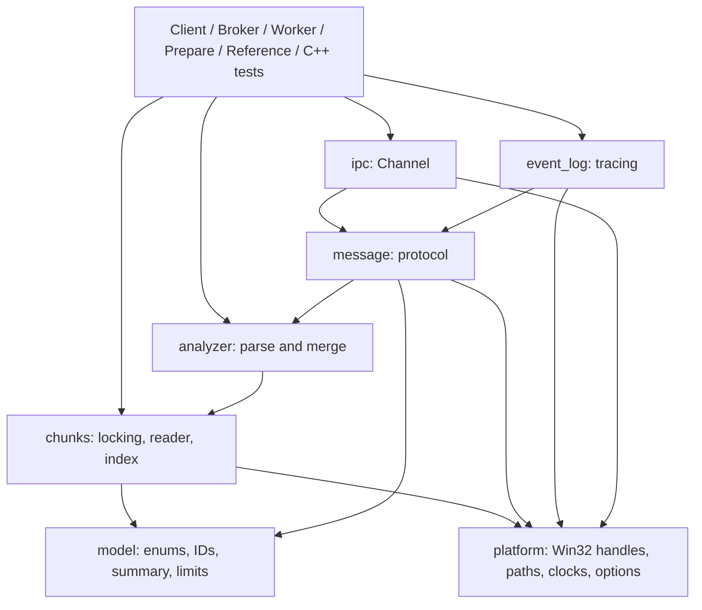

Diagram นี้สรุป service dependencies; ไม่ใช่ exact include graph ของทุก header
ทุก executable ถูก build โดย link common objects ชุดเดียวกัน แม้ runtime ใช้เพียงบางบริการ

### 25.2 Edge catalog สำหรับวาดเองโดยไม่มี source

| จาก → ไป | ชนิดเส้น / payload |
|---|---|
| User → GUI | Actions และ parameter values |
| User → Console Client | Text commands |
| GUI → Prepare | Launch process พร้อม path/chunk size; wait exit |
| Prepare → CSV/index | Read CSV / write sidecar metadata |
| GUI → Client | stdin text commands |
| Client → GUI | stdout JSON responses และ text logs |
| Client ↔ Broker | One local duplex pipe; SUBMIT/STATUS/CANCEL/SHUTDOWN และ replies |
| Broker ↔ Worker i | Dedicated local duplex pipe; READY/TASK/RESULT/SHUTDOWN/ACK |
| Broker → CSV | Stable read lock และ FileStamp inspection |
| Broker → index | Bounded metadata read |
| Worker i → CSV | Read assigned [begin,end) จาก original path |
| C++ components → trace files | Append flushed JSONL with QPC/IDs |
| Trace files → GUI | Incremental tail สำหรับ events/timeline |
| Reference → CSV | Serial read ของทั้งไฟล์ |
| tests/experiments → executables | Process orchestration และ expected-result comparison |
| Producer/Consumers ↔ buffer | Actual shared S2 memory ภายใต้ mutex |
| MOS processes ↔ semaphores | wait/signal, FIFO waiting queues, runnable flags |
| Timer → CPU/int0 | Interrupt request; context switch ผ่าน PCB |
| S2 CPU → observer → validator | Actual state snapshots → invariant checking |
| RISC-V build → compiler/binutils/native test | Object inspection และ host semantics; ไม่มี runtime arrow ไป analyzer |

อย่าเพิ่มเส้น GUI→Worker direct, Worker→Worker pipe, Broker→MOS หรือ S2→RV32I
ไม่มี API/message ใน implementation รองรับเส้นเหล่านั้น

### 25.3 ตรวจ diagram ก่อนส่งต่อ

- แต่ละกล่องระบุให้ได้ว่าเป็น process, module, data file, queue หรือ simulated process
- เส้นแต่ละเส้นมีทิศทางและชื่อข้อมูล/transport ไม่ใช้คำว่า “เชื่อมกัน” อย่างเดียว
- Job/request/chunk/Worker IDs แยกความหมายและ scope
- ภาพ CSV แสดง original file เดียวกับ byte ranges ไม่ใช่ copy file ต่อ Worker
- Ready Job queue ต่างจาก outgoing I/O queues และ semaphore wait queues
- State Failed ไม่ทำให้ outstanding assignments หายจากรูปทันที
- CancelAck และ Cancelled เป็นคนละจุดและใช้คนละ request ID
- มีความต่างระหว่าง assignment busy, parser compute และ process CPU time
- ระบุว่า Windows I/O completion กับ MOS ISR เป็นคนละ abstraction
- RISC-V diagram ไม่อ้าง hardware/emulator execution ที่ยังไม่ได้ทดสอบ

คำถามตรวจความเข้าใจ:
ถ้า C3 กลับก่อน C1 ทำไมยังรวมผลได้? ถ้า Worker หลุดหลัง CANCEL_ACK ใครคืน in-flight?
ทำไม ACCEPTED ไม่รับประกัน header ถูก? ทำไมต้องถือ lock หลัง FAILED?
ทำไม GUI ใช้เวลาที่อ่าน trace มาวาด compute ไม่ได้?
คำตอบอยู่ใน identity validation, ownership, admission boundary และ timing boundaries ที่อธิบายข้างต้น

<a id="s26"></a>
## 26. ข้อจำกัดและ troubleshooting

### 26.1 Resource limits

| Resource | Limit |
|---|---:|
| CSV input | 8 GiB |
| ไม่มี index แล้ว fallback ได้ | ≤8 MiB |
| Chunks ต่อ Job | 65,536 |
| Aggregation error keys ต่อ Job | 4,096 |
| Workers ต่อ session | 1–8, default 3 |
| Nonterminal capacity | 1–128, default 32 |
| Retained Broker Job records | 256 |
| Wire payload | 2 MiB/frame |
| Outgoing Channel queue | 64 frames และ 4×(max_payload+12) bytes |
| Decoder buffered input | 2×(max_payload+12) bytes |
| Client command / queued commands | 8,192 bytes / 128 |
| Record / route | 1,024 / 256 UTF-8 bytes |
| Runtime PROGRESS | ประมาณไม่เกิน 20 Hz/Job; ข้าม intermediate เมื่อ backlog |

Input size bound ไม่ได้แปลว่าเวลา parse คงที่
History/model/queue มี bounds แต่ runtime trace files โตตามจำนวน events จนจบ session
ไม่มี log rotation/durable history database และไม่เก็บ recovery state ของ Job หลัง Broker exit

### 26.2 Troubleshooting

| อาการ | สาเหตุที่ควรตรวจ / การแก้ |
|---|---|
| IntelliSense หา windows.h หรือ standard headers ไม่เจอ | เปิด project root, ตรวจ compilerPath/GCC installation แล้ว reset IntelliSense/reload |
| GUI บอก missing executable | รัน scripts/build.ps1 และตรวจ build exit code |
| Pipe connection timed out | Broker ต้องเปิดก่อน, session/Worker IDs ต้องตรง, endpoint ต้องไม่ถูก session ชื่อซ้ำยึด |
| Submit ถูก REJECTED เพราะ Prepare | สร้าง index ด้วย Prepare สำหรับไฟล์ใหญ่ |
| Stale chunk index | Prepare ใหม่จากไฟล์ปัจจุบัน; อย่าคัดลอก sidecar เก่าแทน identity ใหม่ |
| ACCEPTED แล้ว FAILED header | ไฟล์เล็กใช้ fallback จึงเพิ่งตรวจ header ที่ Worker |
| Aggregation key limit exceeded | มี error keys เกิน 4,096; เปลี่ยน workload ให้ตรง scope/เพดาน |
| Write/delete CSV ไม่ได้ระหว่างงาน | Broker/Workers ตั้งใจถือ read lock; รอ settlement ไม่ใช่แค่เห็น FAILED |
| CancelAck แล้ว Worker ยัง Busy | กำลังจบ chunk ปัจจุบัน; รอ Cancelled หรือรับรู้ disconnect |
| shutdown ถูก reject | มี Job/assignments ยังไม่ settled; cancel หรือรอแล้วสั่งใหม่ |
| GUI result หายหลังงานจำนวนมาก | Broker evict history เก่าและ STATUS ทำให้ model ตรง snapshot |
| GUI timeline ว่าง | ยังไม่มี task_assigned ที่มี QPC หรือกำลังดูคนละ session; timeline ไม่สร้างเหตุการณ์สมมติ |
| MOS compile/tool error | ต้องมี Rz36/as21/GCC; อ่าน step log ใน output directory |
| MOS ไม่จบ/validator reject | ตรวจ scheduler mode, configuration, max-clocks และ validation error; ไม่ถือว่ามี trace เท่ากับผ่าน |
| MOS timer เปลี่ยนแล้วเวลาไม่ใช่ ms | หน่วยเป็น S2 simulation clocks |
| RISC-V toolchain not found | ระบุ --toolchain ที่มี prefixed GCC/objdump/readelf |
| Measurement บอก A finished before B | Workload เล็กเกินที่จะ overlap; เพิ่ม A หรือใช้ controlled-delay experiment ตามวัตถุประสงค์ |

### 26.3 Outputs และ scope ที่ต้องรักษา

Outputs ปกติอยู่ใต้ build/: binaries/objects, generated datasets,
experiment results, traces, MOS generated sources/objects/logs และ RISC-V artifacts
ข้อยกเว้นคือ Prepare sidecar และ generator metadata อยู่ข้าง CSV ที่เลือก
Python อาจสร้าง __pycache__; outputs/caches ถูก ignore และสร้างใหม่ได้เมื่อมี source/tools

MOS/tools/as21.exe และ rz36.exe เป็น required course inputs ไม่ใช่ project build outputs จึงถูก track ตามปกติ
ไม่ควรส่ง build/history/evidence/archives แทนเอกสารอธิบาย implementation

Security boundary: local pipes ใช้ Windows access control ของ endpoint และ reject remote clients
ไม่มี application login, encryption หรือการยืนยันว่า process ที่เปิด local pipe เป็น Worker binary ที่เชื่อถือได้
Identity validation ป้องกันสับสน/duplicate assignment แต่ไม่พิสูจน์ว่า peer ที่มุ่งร้ายคำนวณ counts จริง
Python oracle/serial comparisons เป็นการตรวจ correctness ของ experiments/tests ไม่ใช่ runtime authentication

ไม่มี reconnect/retry/restart, task checkpoint, distributed worker, adaptive scheduler หรือ preemption กลาง chunk
Worker ที่ hang แต่ไม่ disconnect ไม่มี computation timeout ใน Broker; GUI stop มี force fallback
งานนี้เป็นการศึกษา concurrency/correctness บน synthetic/local workload
การเพิ่มขอบเขตเหล่านี้ต้องออกแบบ semantics และ tests เพิ่มก่อน ไม่ควรอนุมานจาก diagram ว่ารองรับอยู่แล้ว
