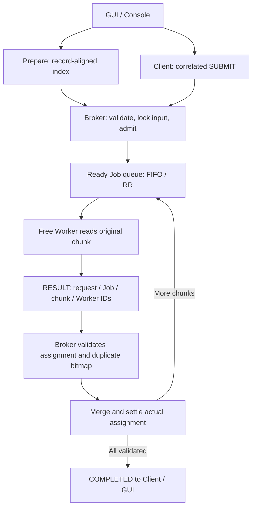

# Asynchronous Multi-Process Log Analyzer

ระบบ C++17 บน Windows สำหรับศึกษา communication, concurrency, scheduling และ ownership:
**Client → Broker → Workers → Broker → Client** ผ่าน Named Pipes + Overlapped I/O จริง
มี Python/Tk GUI, serial reference, seeded generator และการทดลอง MOS/S2 ของวิชา

## Setup, build และ run

ต้องมี Windows, GCC C++17 (`g++` และ `gcc` ใน PATH), Python 3.10+ พร้อม Tkinter
แอปและเครื่องมือทดสอบใช้ standard library เท่านั้น ไม่มี pip dependencies

```powershell
./scripts/build.ps1
python Client/gui.py
```

ใน VS Code ให้เปิดโฟลเดอร์ `midterm-project` ทั้งโฟลเดอร์ด้วย Open Folder
ไฟล์ `.vscode/c_cpp_properties.json` ตั้ง IntelliSense ให้ใช้ GCC ตัวเดียวกับเครื่องนี้
ที่ `C:/TDM-GCC-64/bin/g++.exe` พร้อม C++17 และ include path `Common/`
Compiler จะระบุ system headers รวมถึง `windows.h` และ C++ standard library ให้อัตโนมัติ
ถ้าเปลี่ยนที่ติดตั้ง GCC ให้แก้ `compilerPath` ในไฟล์นี้
ถ้ายังเห็น error เดิม ให้ใช้ Command Palette → `C/C++: Reset IntelliSense Database`
แล้ว `Developer: Reload Window`

GUI: เลือก Workers, FIFO/Round-robin, Chunk KiB และ Capacity → Start cluster →
เลือก CSV และ Route/Time → Prepare & submit
ส่งงานเพิ่ม, Refresh หรือ Cancel selected ระหว่างงานเดิมทำได้
Stop ขอ cancel และรอ settlement; หลัง 8 วินาทีจึง terminate เฉพาะ child processes ของ session นี้

สร้างข้อมูลและเตรียม index สำหรับ console:
```powershell
python scripts/generate.py --file build/demo.csv --records 100000 --seed 42
./build/prepare.exe --file build/demo.csv --chunk-bytes 65536
./build/broker.exe --session demo --workers 3 --policy rr --capacity 32
```
เปิด terminals อื่นใน project root:
```powershell
./build/worker.exe --session demo --id 1
./build/worker.exe --session demo --id 2
./build/worker.exe --session demo --id 3
./build/client.exe --session demo
```

คำสั่ง Client:
```text
submit route "build/demo.csv"
submit time "build/demo.csv"
status
status 1
cancel 1
shutdown
quit
```

ใช้ Job ID ที่ได้รับจริง `shutdown` ใช้เมื่อไม่มีงาน/assignment ค้าง
`quit` และ stdin EOF รอคำขอที่ส่งแล้วให้จบ
Client หลุดกะทันหันทำให้ Broker ยกเลิกงานและ settle ก่อนออก
คำสั่งรับได้ 8,192 UTF-8 bytes ไม่รวม LF/CRLF และคิว 128 คำสั่ง
input error แสดงสาเหตุ หยุดรับคำสั่งใหม่ และ drain คำขอที่ส่งแล้ว

## ทดสอบ

```powershell
./scripts/test.ps1
```

คำสั่งนี้ build ใหม่แล้วรัน C++ contracts, real-process tests, GUI/native widgets,
measurement tests, MOS matrix/regressions และ RV32I compilation/native semantics
MOS ต้องใช้ tools ที่เก็บใน `MOS/tools/`; RISC-V prerequisites อยู่ด้านล่าง

คำสั่งแยกหลัง build:
```powershell
python tests/processes.py
$env:LGA_GUI_PROCESS_TESTS = '1'
python -m unittest discover -s tests -p test_gui.py -v
python -m unittest discover -s tests -p test_experiments.py -v
Remove-Item Env:LGA_GUI_PROCESS_TESTS
python -m unittest discover -s MOS/tests -p test_mos.py -v
python MOS/riscv/build.py
```

Process tests ครอบคลุม Route/Time เทียบทุก key กับ hand-count/serial/Python oracle,
BOM/CRLF/EOF/invalid/giant records, framing, Unicode paths, out-of-order,
FIFO/RR, queued/active cancel, duplicate/wrong/late result, capacity/history/handles,
Worker/Client loss, repeated shutdown และขอบเขต stdin
การไม่ตั้ง `LGA_GUI_PROCESS_TESTS=1` จะ skip เฉพาะ GUI process/native-window tests

`data/small.csv` เป็น fixture ต้นฉบับ: valid 7, malformed 3, errors 5
Route: /login=2, /payment=3; UTC minute: 10:00=2, 10:01=2, 10:02=1
ไฟล์ expected JSON เป็นคำตอบอิสระที่ใช้ใน tests

## โครงสร้างและเส้นทางอ่านโค้ด

```text
Broker/main.cpp              admission, job state, FIFO/RR, merge, settlement
Client/main.cpp              stdin thread, request IDs, pipe event loop
Client/gui.py                model, trace reader, owned processes, Tk window
Worker/main.cpp              รับหนึ่ง chunk, analyze, ส่ง RESULT
Prepare/main.cpp             สร้าง record-boundary index ก่อน submit
Reference/main.cpp           serial analyzer และ QPC timing
Common/
  model.hpp                  IDs, enums, counts, limits
  platform.hpp               Win32 handles, Unicode, clocks, options
  chunks.hpp/.cpp            locked input, bounded reader, index
  analyzer.hpp/.cpp          CSV parser และ atomic validated merge
  message.hpp/.cpp           binary framing/serialization และ display JSON
  ipc.hpp/.cpp               pipe/OVERLAPPED/buffer ownership
  event_log.hpp              runtime QPC trace ที่ monitor/tests ใช้
scripts/
  build.ps1, test.ps1         build และ test entry points
  generate.py                reproducible synthetic input
  experiments.py             actual/controlled benchmark matrices
tests/
  common_tests.cpp           parser, index, wire, overflow contracts
  processes.py               transport, concurrency, resource acceptance
  support.py                 owned Cluster, raw peer, oracle, telemetry
  test_gui.py                GUI model/trace/process/widget regressions
  test_experiments.py         metric boundaries และ live trace checks
MOS/
  course/                    original mos-rz2.txt และ C S2 simulator
  tools/                     course Rz compiler/assembler
  buffer-app.rz              bounded circular buffer
  scheduler-nextp.rz         interrupt-safe scheduler helper
  observer.c                 อ่าน actual simulator registers/memory
  run.py, validate_trace.py   compile/run และตรวจ trace
  tests/test_mos.py           12 configurations + negative regressions
  riscv/                     count_errors.c, test_count_errors.c, build.py
data/                        small.csv และ expected Route/Time JSON
README.md                    คู่มือปัจจุบันและ contracts
AGENT.md, AGENTS.md           ข้อกำกับการแก้โค้ด
Full_Context.md              โจทย์ต้นฉบับ; ไม่ใช่คู่มือสถานะปัจจุบัน
```

เริ่มอ่าน Worker → analyzer → chunks → message → ipc → Broker → Client → GUI
`Common` เป็น source library ที่ link เข้าแต่ละ executable ไม่ใช่ shared memory



Broker มี event loop เดียวเป็นเจ้าของ state ทั้งหมด
ขั้นตอนใน loop: Client commands → Worker results → dispatch → shutdown → wait-any
FIFO แจก Job เก่าจนไม่มี chunk เหลือให้แจก ส่วน RR หมุน Job หลังแต่ละ assignment
ทั้งสองไม่ preempt กลาง chunk และ dispatch order อาจต่างจาก completion order

## CSV, index และ correctness contracts

- UTF-8, optional BOM, LF/CRLF, final newline optional; header ต้องเป็น `timestamp,route,status`
- สาม unquoted fields ต่อ physical line; ไม่มี CSV quoting, escaping หรือ multiline
- Timestamp `YYYY-MM-DDTHH:MM:SSZ`, UTC Gregorian ปี 1970–9999, ตรวจ leap/day/time
- Route เริ่ม /, ไม่เกิน 256 UTF-8 bytes; ห้าม ASCII whitespace/control, DEL, double quote และ comma
- HTTP status เป็นสามหลัก 100–599; errors 400–599 แยก 4xx/5xx
- Record ไม่เกิน 1,024 bytes หลังตัด CR; invalid/blank line นับ malformed หนึ่งครั้ง
  Reader เก็บไม่เกิน 1,026 bytes แม้บรรทัดเสียยาวมาก
- Time analysis รวมเป็น UTC minute; header-only ให้ผลศูนย์; missing/wrong header ล้มเหลว
- Counts เป็น u64, ผล sort ตาม key; ทุก record ต้องอยู่ใน valid หรือ malformed

Prepare สร้าง `<input>.lgaidx` แบบ atomic โดยขยับ byte target ไปขอบ LF
ช่วง chunk เป็น [begin,end), ต่อกันตั้งแต่ศูนย์ถึง EOF; chunk แรกข้าม header
Worker ตรวจ header, file identity และ boundary ซ้ำ
ไฟล์ไม่เกิน 8 MiB ที่ไม่มี index ใช้ single-chunk fallback; index ที่มีแต่ stale ต้อง reject
หลัง copy/move/edit CSV ต้อง Prepare ใหม่

Index เป็น little-endian: LGI2 magic/u32 version=1, size/mtime/volume/file_id/
target_bytes/chunk_count (u64 อย่างละหนึ่ง) แล้ว begin/end u64 ทุก chunk
Broker ถือ read-lock (FILE_SHARE_READ เท่านั้น) จน assignments settle รวมกรณี cancel/failure
จึงเปิดอ่านร่วมกันได้ แต่ปฏิเสธ writers/deletion; metadata identity ไม่ใช่ content hash

เพดาน: input 8 GiB, chunks 65,536/Job, result keys 4,096/Job, Workers 1–8
(default 3), nonterminal Jobs 1–128 (default 32), retained Jobs 256
terminal history ถูกตัดได้เฉพาะเมื่อไม่มี assignment ค้าง
GUI เก็บ events 2,000, spans 2,048 และแสดง 160 chunks ล่าสุด

Invariants ที่ต้องรักษา:
1. ทุกบรรทัดอยู่ใน chunk เดียว
2. Worker มี assignment เดียว
3. RESULT ตรง request/job/chunk/Worker ที่ได้รับมอบหมาย
4. Merge chunk ได้ครั้งเดียว
5. Completed เมื่อครบทุก validated chunk
6. Cancelled/Failed ไม่กลับ Completed จาก late result
7. คืน Worker และ input lock ตาม actual settlement

Job states: Queued → Active → Completed; cancellation หยุดแจกใหม่และใช้ Cancelling
จน assignments จบจึง Cancelled; Failed เป็น terminal แต่ยังต้อง settle Workers อื่น
Worker loss กระทบ Job ที่ถืออยู่ งานอื่นใช้ Workers ที่เหลือต่อได้

## IPC และ traces

ใช้ duplex local byte-stream Named Pipes, FILE_FLAG_OVERLAPPED และ wait-any
แยก read/write OVERLAPPED, buffers, events; pending resources ต้องอยู่จน collect completion
close ใช้ CancelIoEx แล้ว GetOverlappedResult ก่อนคืน memory/handles
I/O completion ไม่ใช่ ISR; Windows schedule CPU ส่วน Broker schedule chunks

Wire v2: 12-byte header = LGA1 (4), version u16=2, kind u16, payload length u32
ทุกจำนวน little-endian; payload สูงสุด 2 MiB; string = u32 byte length + UTF-8 ไม่มี NUL
Decoder รองรับ fragmented/coalesced frames และ reject invalid enums/length/counts/trailing bytes
Kinds: READY=1, SUBMIT=2, ACCEPTED=3, REJECTED=4, TASK=5, RESULT=6,
STATUS_REQUEST=7, STATUS=8, COMPLETED=9, FAILED=10, SHUTDOWN=11,
SHUTDOWN_ACK=12, CANCEL=13, CANCEL_ACK=14, CANCELLED=15, PROGRESS=16
รายละเอียด field order อยู่ติดกันใน encode/decode ของ `Common/message.cpp`

request_id เป็น positive u64 เพิ่มตลอด connection; Job/chunk IDs เป็น positive u64
Submit replies/progress/final ใช้ request เดิม; CancelAck ตอบ Cancel request
ส่วน Cancelled ตอบ Submit request เดิม
ตรวจ assignment identity ก่อนคืน Worker/merge; ตรวจ overflow/key limit ก่อนเปลี่ยน summary

แต่ละ pipe จำกัด outgoing 64 frames / 4 × (max_payload + 12) bytes
PROGRESS จำกัดประมาณ 20 Hz/Job และข้าม intermediate updates เมื่อ backlog สูง
STATUS/terminal ไม่ throttle; หากส่ง final ไม่ได้ให้ disconnect และ settle ชัดเจน
QPC traces เก็บทุก validated merge; TASK/RESULT ไม่อ้าง Broker state ที่ยังไม่ทราบ

GUI อ่าน stdout ของ C++ Client และ trace จริงบน background threads
Tk main thread รับผ่าน bounded queue; ภาพ timeline จับคู่ด้วย Job/chunk/Worker IDs
Trace/runtime logs เป็นข้อมูลระหว่างการทำงาน จัดเก็บใน `build/traces/` ไม่ใช่ source

## การทดลอง Windows

```powershell
python scripts/experiments.py
# ตรวจ matrix ครบ configuration แต่ลดเหลือหนึ่ง repetition:
python scripts/experiments.py --repeats 1
```

Default: A=500,000 records, B=1,000, seed=20261017, 3 repetitions
225 clusters รวม real A-alone/B-alone/mixed ที่ FIFO/RR × Workers 1/2/3 ×
chunk 64/256/1024 KiB, Time analysis ทุก Worker/chunk combination และ
controlled async/sequential-wait ด้วย Workers 2, A=10,000/B=500, delays 120/12 ms
ผลทุก Job ต้องตรง serial และ independent Python oracle ก่อนวัด
ผลปัจจุบันอยู่ `build/experiments.json`; failed run มี passed=false

- Admission: Client command_started → Client ได้ ACCEPTED
- Queue: Broker accepted → first assignment; turnaround: accepted → completed
- Client response: command_started → COMPLETED
- Throughput: valid records / ช่วงรับงานแรกจนจบงานสุดท้ายใน run
- Busy fraction: เวลาถือ assignment; CPU fraction: process kernel+user time / sample duration
- Slowdown: mixed turnaround / same-config same-repeat alone turnaround
- Jain index ใช้ inverse slowdowns; ใกล้ 1 ไม่ได้แปลว่า latency ต่ำ
- IPC counters รวม response ของ STATUS ก่อนงานกับ request ของ STATUS หลังงาน

Serial timing ไม่รวม startup/serialization; multiprocess timing รวม IPC/scheduling/trace
ไม่ flush cache/ควบคุม OS load; แยก artificial delay ออกจาก parsing throughput
ไม่มีข้อสรุป hard real-time, energy savings หรือ speedup ที่รับประกัน

## MOS/S2 และ RISC-V

```powershell
python MOS/run.py --capacity 3 --items 24 --consumers 2 --timer 400
python MOS/validate_trace.py build/mos/k3-c2-t400/trace.jsonl
```

run.py ใช้ course Rz36 → as21 → object → actual C S2 simulator + observer
มี Producer หนึ่งตัว, Consumers 1–8, circular buffer K=1–64
empty=K, full=0, mutex=1; Producer wait(empty/mutex), write tail, signal(mutex/full)
Consumer wait(full/mutex), read head, signal(mutex/empty)
จำนวน items ต้องหาร consumers ลงตัว; timer มีหน่วย S2 simulation clocks ไม่ใช่ ms

Original int0() เก็บ PC/SP/FP/rads/retval และ pushm r0..r15 ลง stack
แล้วคืนจาก PCB ที่เลือกก่อน reti
nextp() เดิมใช้ interrupted frame ทำให้ข้อมูลผิดได้; scheduler-nextp.rz ใช้
#noframe กับ scratch r20/r21 โดยคง int0() ต้นฉบับ
Tests ตรวจ 12 K/consumer/timer configurations, FIFO/no loss/duplication,
semaphore wait/wakeup, PCB/register restoration, corrupt trace rejection
และ expected failure ของ scheduler เดิม

เก็บต้นฉบับที่จำเป็น: MOS/course/mos-rz2.txt มาจาก
`C:/2110585_Hardware_Design/mos-writer-reader/mos-rz2.txt`
(SHA-256 ff0feced5adb869d39c57e6502d87301f47f51e9487a03b26ed1af6e121aa8d0)
C simulator มาจาก `C:/2110585_Hardware_Design/iot-rz/sim21/`
tools rz36.exe/as21.exe มาจาก `mos-writer-reader/tools/`
คง original author headers; build adapters เปลี่ยนเฉพาะสำเนาใน build/
เครื่องมือ binary ของวิชาสองไฟล์นี้เป็น input ที่จำเป็น ไม่ใช่ output ของโปรเจกต์

RV32I เป็นตัวอย่าง ISA แยกจาก S2:
```powershell
python MOS/riscv/build.py
# ถ้า toolchain อยู่ที่อื่น:
python MOS/riscv/build.py --toolchain C:/path/to/bin
```
ต้องมี riscv32-esp-elf-gcc/objdump/readelf; default อยู่ที่
`%LOCALAPPDATA%/Arduino15/packages/esp32/tools/esp-rv32/2411/bin`
ตรวจ RV32I ELF, load/store/branch และ native C semantics
ยังไม่ execute RISC-V object บน emulator/hardware

## Outputs และข้อจำกัด

Binaries, objects, indexes ของข้อมูลทดลอง, logs, traces และผลวัดสร้างใหม่ใน `build/`
Prepare เขียน sidecar ข้าง CSV ที่ผู้ใช้เลือกเสมอ; ถ้าใช้ fixture อาจมี `data/*.lgaidx`
Python อาจสร้าง `__pycache__`; ทั้ง caches และ outputs ไม่ต้องเก็บใน source
ลบ `build/` ได้เมื่อปิด processes ของโปรเจกต์แล้ว และรัน build/test เพื่อสร้างใหม่
ไม่มี archive, release ZIP, historical reports, plot dependency หรือ alternate build system

หนึ่ง Client ต่อ session, ไม่มี reconnect/retry/restart; cancellation ที่ขอบ chunk
ข้อมูล synthetic, synchronous trace มี overhead และไม่มี hardware ภายนอก
โจทย์เดิมอยู่ Full_Context.md; การดูแลโค้ดปัจจุบันใช้ README และ AGENT.md
